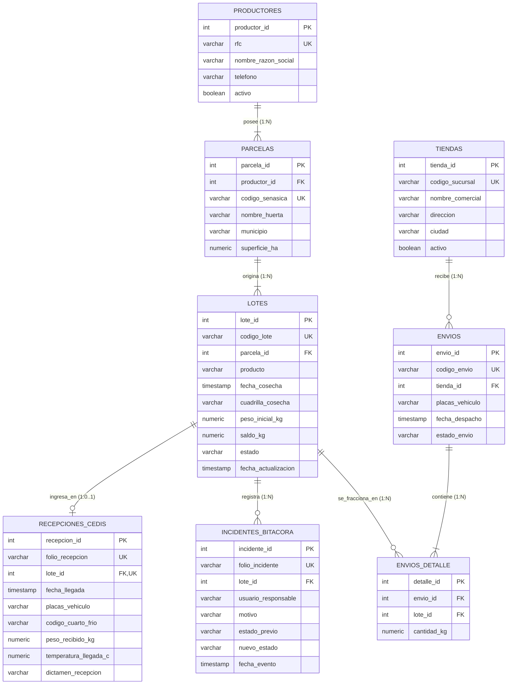
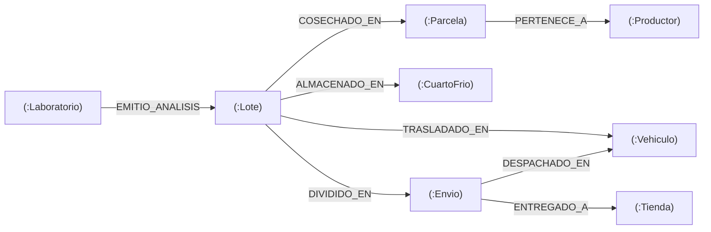

# Modelado de Datos: TrazaAgro

Este documento reúne el diseño conceptual y lógico de los datos para la plataforma **TrazaAgro**. Su propósito es garantizar que los tres motores de persistencia (PostgreSQL, MongoDB y Neo4j) representen el mismo dominio agrícola y logístico sin contradicciones, definiendo responsabilidades claras y una única fuente de verdad para cada dato.

## 1. Modelo Conceptual Común del Dominio

El flujo operativo de TrazaAgro sigue la vida completa de la fruta fresca (caso de estudio: Aguacate Hass) desde la huerta hasta el punto de venta final. Para representar el dominio sin depender todavía de ningún motor específico, se identifican 10 entidades esenciales y sus relaciones de negocio.

### Entidades del dominio y sus propiedades

**Productor**
Persona física o empresa agrícola dueña o responsable de las huertas.
* `id_productor`: Entero / UUID | Obligatoria | Única: Sí
* `rfc_o_identificacion_fiscal`: Texto (13) | Obligatoria | Única: Sí
* `nombre_o_razon_social`: Texto (120) | Obligatoria | Única: No
* `telefono_contacto`: Texto (15) | Obligatoria | Única: No
* `estado_activo`: Booleano | Obligatoria | Única: No

**Parcela**
Unidad física de tierra agrícola donde se cultiva y cosecha el producto, sujeta a registro fitosanitario.
* `id_parcela`: Entero / UUID | Obligatoria | Única: Sí
* `codigo_senasica_registro`: Texto (30) | Obligatoria | Única: Sí
* `nombre_huerta`: Texto (100) | Obligatoria | Única: No
* `municipio`: Texto (60) | Obligatoria | Única: No
* `superficie_hectareas`: Decimal (6,2) | Opcional | Única: No

**Lote**
Entidad central que agrupa fruta recolectada en una fecha, parcela y cuadrilla específica bajo un código maestro.
* `codigo_lote`: Texto (30) (ej. `AGU-P014-260312-01`) | Obligatoria | Única: Sí
* `producto`: Texto (60) (ej. `Aguacate Hass`) | Obligatoria | Única: No
* `fecha_cosecha`: Timestamp / Date | Obligatoria | Única: No
* `cuadrilla_cosecha`: Texto (50) | Obligatoria | Única: No
* `peso_inicial_kg`: Decimal (10,2) | Obligatoria | Única: No
* `saldo_kg`: Decimal (10,2) | Obligatoria | Única: No
* `estado`: Texto (20) (`Cosechado`, `Recibido`, `En revision`, `Liberado`, `Bloqueado`, `Retirado`) | Obligatoria | Única: No

**Vehículo**
Unidad de transporte refrigerado empleada para traslados de la huerta al CEDIS o del CEDIS a tienda.
* `placas`: Texto (15) | Obligatoria | Única: Sí
* `nombre_chofer`: Texto (100) | Obligatoria | Única: No
* `tipo_refrigeracion`: Texto (40) | Obligatoria | Única: No
* `temperatura_minima_operativa_c`: Decimal (4,1) | Opcional | Única: No

**Recepción en CEDIS**
Evento de control físico y administrativo al llegar el transporte a bodega.
* `folio_recepcion`: Texto (25) | Obligatoria | Única: Sí
* `fecha_hora_llegada`: Timestamp | Obligatoria | Única: No
* `peso_recibido_kg`: Decimal (10,2) | Obligatoria | Única: No
* `temperatura_llegada_c`: Decimal (4,1) | Obligatoria | Única: No
* `dictamen_inspeccion`: Texto (20) (`Conforme`, `Retenido`, `Rechazado`) | Obligatoria | Única: No

**Cuarto Frío**
Cámara o zona de almacenamiento con temperatura controlada dentro del CEDIS (rango operativo óptimo para aguacate Hass: `5.0` a `7.0` °C).
* `codigo_cuarto_frio`: Texto (15) (ej. `CF-02`) | Obligatoria | Única: Sí
* `nombre_cuarto`: Texto (50) | Obligatoria | Única: No
* `temperatura_objetivo_c`: Decimal (4,1) | Obligatoria | Única: No
* `capacidad_tarimas`: Entero | Opcional | Única: No

**Análisis de Laboratorio**
Certificado técnico emitido por un laboratorio externo sobre muestras tomadas de un lote.
* `folio_analisis`: Texto (35) | Obligatoria | Única: Sí
* `nombre_laboratorio`: Texto (100) | Obligatoria | Única: No
* `fecha_emision`: Timestamp / Date | Obligatoria | Única: No
* `tipo_estudio`: Texto (40) (`Residuos de Plaguicidas`, `Microbiologico`, `Materia Seca`) | Obligatoria | Única: No
* `dictamen_general`: Texto (20) (`Conforme`, `No Conforme`) | Obligatoria | Única: No
* `es_vigente`: Booleano | Obligatoria | Única: No

**Envío**
Orden de salida y despacho fraccionado desde el CEDIS hacia un cliente comercial (el total de kilogramos del envío se calcula a partir de la suma de `cantidad_kg` de los lotes incluidos).
* `codigo_envio`: Texto (30) (ej. `ENV-2026-1052`) | Obligatoria | Única: Sí
* `fecha_despacho`: Timestamp | Obligatoria | Única: No
* `estado_envio`: Texto (20) (`Preparado`, `En transito`, `Entregado`, `Cancelado`) | Obligatoria | Única: No

**Tienda**
Punto de venta o consumo final: supermercado, sucursal o restaurante receptor.
* `id_tienda`: Entero / UUID | Obligatoria | Única: Sí
* `codigo_sucursal`: Texto (20) | Obligatoria | Única: Sí
* `nombre_comercial`: Texto (100) | Obligatoria | Única: No
* `direccion_entrega`: Texto (200) | Obligatoria | Única: No
* `ciudad`: Texto (60) | Obligatoria | Única: No
* `activo`: Booleano | Obligatoria | Única: No

**Incidente / Bitácora de QA**
Registro formal de contingencia, liberación, bloqueo o retiro sanitario aplicado a un lote.
* `folio_incidente`: Texto (30) | Obligatoria | Única: Sí
* `fecha_hora_registro`: Timestamp | Obligatoria | Única: No
* `tipo_evento`: Texto (30) (`Bloqueo Preventivo`, `Liberacion`, `Alerta de Retiro`) | Obligatoria | Única: No
* `motivo`: Texto (250) | Obligatoria | Única: No
* `usuario_responsable`: Texto (60) | Obligatoria | Única: No

### Relaciones entre entidades

| Entidad de origen | Nombre de la relación | Entidad de destino | Descripción de su significado |
| :--- | :--- | :--- | :--- |
| **Parcela** | `PERTENECE_A` | **Productor** | Indica la huerta o terreno asignado a un productor registrado. |
| **Lote** | `COSECHADO_EN` | **Parcela** | Identifica el origen agronómico exacto de la fruta para rastreo hacia atrás. |
| **Lote** | `TRASLADADO_EN` | **Vehículo** | Asocia la unidad refrigerada que trasladó la fruta desde la huerta al CEDIS. |
| **Recepción en CEDIS** | `INSPECCIONA` | **Lote** | Registra el control físico de pesaje, temperatura y calidad al llegar el lote. |
| **Lote** | `ALMACENADO_EN` | **Cuarto Frío** | Define la cámara de refrigeración donde se estiba el lote tras su recepción en bodega. |
| **Análisis de Laboratorio** | `EVALUA` / `EMITIO_ANALISIS` | **Lote** | Vincula los resultados químicos o microbiológicos y el laboratorio emisor con el lote específico. |
| **Lote** | `DIVIDIDO_EN` | **Envío** | Representa la separación física y descuento de kilogramos para surtir pedidos. |
| **Envío** | `DESPACHADO_EN` | **Vehículo** | Registra el camión de reparto que lleva el pedido consolidado del CEDIS a su destino. |
| **Envío** | `ENTREGADO_A` | **Tienda** | Conecta el envío con el punto de venta final donde se comercializa el producto. |
| **Incidente de QA** | `BLOQUEA_O_AUDITA` | **Lote** | Documenta la inmovilización administrativa, expediente de retiro (recall) o auditoría sanitaria aplicada al lote. |

## 2. Asignación al Modelo Lógico Relacional (PostgreSQL)

Para evitar redundancias sin control, PostgreSQL actúa como **fuente de verdad transaccional y administrativa**. De las 10 entidades del dominio, 8 se materializan como tablas relacionales: `productores`, `parcelas`, `lotes`, `recepciones_cedis`, `tiendas`, `envios`, `envios_detalle` e `incidentes_bitacora`.

Las entidades y atributos restantes se delegan a los otros motores por su naturaleza:
* **Análisis de Laboratorio**, **Evidencias flexibles de recepción** (fotos, observaciones libres) y **Expedientes de Incidentes y Retiro (Recall)** (tiendas notificadas, causa raíz, acciones correctivas y firmas de cierre) viven en **MongoDB**, vinculados mediante `codigo_lote`, `folio_recepcion` y `folio_incidente`.
* **Vehículo**, **Cuarto Frío** y **Laboratorio** (como nodo ligero analítico) no requieren tablas maestras complejas en SQL para el MVP; en PostgreSQL se conservan sus identificadores operativos (`placas_vehiculo` y `codigo_cuarto_frio`), mientras que en **Neo4j** funcionan como nodos puente para detectar contaminación cruzada lateral y patrones compartidos.

### Cardinalidades en PostgreSQL

* **`productores` (1) a `parcelas` (N):** Un productor posee una o más parcelas; cada parcela pertenece a un solo productor.
* **`parcelas` (1) a `lotes` (N):** De una parcela se cosechan múltiples lotes en distintas fechas; cada lote proviene de una única parcela.
* **`lotes` (1) a `recepciones_cedis` (0..1):** Un lote recién cosechado aún no tiene recepción; al llegar al CEDIS genera un único registro formal de entrada.
* **`tiendas` (1) a `envios` (N):** Una tienda recibe múltiples envíos; cada orden de envío va dirigida a una sola tienda.
* **`lotes` (N) a `envios` (M) mediante `envios_detalle`:** Un lote puede fraccionarse en múltiples envíos y, a la inversa, un pedido a tienda puede completarse mezclando cajas de más de un lote. La tabla `envios_detalle` resuelve esta relación registrando los kilogramos exactos descontados de cada lote.
* **`lotes` (1) a `incidentes_bitacora` (N):** Un lote puede acumular varios eventos históricos de auditoría o cambios críticos de estado por parte de QA.

### Diagrama Entidad-Relación



### Especificación de tablas, claves y restricciones

**1. `productores`**
* `productor_id`: `SERIAL` (PK)
* `rfc`: `VARCHAR(13)` (NOT NULL, UNIQUE)
* `nombre_razon_social`: `VARCHAR(120)` (NOT NULL)
* `telefono`: `VARCHAR(15)` (NOT NULL)
* `activo`: `BOOLEAN` (NOT NULL, DEFAULT TRUE)

**2. `parcelas`**
* `parcela_id`: `SERIAL` (PK)
* `productor_id`: `INTEGER` (FK hacia `productores(productor_id)` `ON DELETE RESTRICT`, NOT NULL)
* `codigo_senasica`: `VARCHAR(30)` (NOT NULL, UNIQUE)
* `nombre_huerta`: `VARCHAR(100)` (NOT NULL)
* `municipio`: `VARCHAR(60)` (NOT NULL)
* `superficie_ha`: `NUMERIC(6,2)` (NULL, `CHECK (superficie_ha > 0)`)

**3. `lotes`**
* `lote_id`: `SERIAL` (PK; llave interna entera para optimizar `JOIN` e índices en PostgreSQL)
* `codigo_lote`: `VARCHAR(30)` (NOT NULL, UNIQUE, ej. `AGU-P014-260312-01`; llave natural puente hacia MongoDB y Neo4j)
* `parcela_id`: `INTEGER` (FK hacia `parcelas(parcela_id)` `ON DELETE RESTRICT`, NOT NULL)
* `producto`: `VARCHAR(60)` (NOT NULL, ej. `Aguacate Hass`)
* `fecha_cosecha`: `TIMESTAMP` (NOT NULL)
* `cuadrilla_cosecha`: `VARCHAR(50)` (NOT NULL)
* `peso_inicial_kg`: `NUMERIC(10,2)` (NOT NULL, `CHECK (peso_inicial_kg > 0)`)
* `saldo_kg`: `NUMERIC(10,2)` (NOT NULL, `CHECK (saldo_kg >= 0 AND saldo_kg <= peso_inicial_kg)`)
* `estado`: `VARCHAR(20)` (NOT NULL, `CHECK (estado IN ('Cosechado', 'Recibido', 'En revision', 'Liberado', 'Bloqueado', 'Retirado'))`)
* `fecha_actualizacion`: `TIMESTAMP` (NOT NULL, DEFAULT CURRENT_TIMESTAMP)

**4. `recepciones_cedis`**
* `recepcion_id`: `SERIAL` (PK; llave interna entera)
* `folio_recepcion`: `VARCHAR(25)` (NOT NULL, UNIQUE, ej. `REC-2026-0104`; llave natural puente 1:1 hacia `actas_recepcion` en MongoDB)
* `lote_id`: `INTEGER` (FK hacia `lotes(lote_id)` `ON DELETE RESTRICT`, NOT NULL, UNIQUE)
* `fecha_llegada`: `TIMESTAMP` (NOT NULL, DEFAULT CURRENT_TIMESTAMP)
* `placas_vehiculo`: `VARCHAR(15)` (NOT NULL)
* `codigo_cuarto_frio`: `VARCHAR(15)` (NOT NULL)
* `peso_recibido_kg`: `NUMERIC(10,2)` (NOT NULL, `CHECK (peso_recibido_kg > 0)`)
* `temperatura_llegada_c`: `NUMERIC(4,1)` (NOT NULL; rango de tolerancia en transporte y recepción `4.0` a `8.0` °C para aguacate Hass —con operación en cuarto frío de `5.0` a `7.0` °C—; fuera de rango la lógica de negocio retiene el lote en `En revision`)
* `dictamen_recepcion`: `VARCHAR(20)` (NOT NULL, `CHECK (dictamen_recepcion IN ('Conforme', 'Retenido', 'Rechazado'))`)

**5. `tiendas`**
* `tienda_id`: `SERIAL` (PK)
* `codigo_sucursal`: `VARCHAR(20)` (NOT NULL, UNIQUE)
* `nombre_comercial`: `VARCHAR(100)` (NOT NULL)
* `direccion`: `VARCHAR(200)` (NOT NULL)
* `ciudad`: `VARCHAR(60)` (NOT NULL)
* `activo`: `BOOLEAN` (NOT NULL, DEFAULT TRUE; permite inactivar sucursales sin borrado físico conforme a `RN-10`)

**6. `envios`**
* `envio_id`: `SERIAL` (PK)
* `codigo_envio`: `VARCHAR(30)` (NOT NULL, UNIQUE, ej. `ENV-2026-1052`)
* `tienda_id`: `INTEGER` (FK hacia `tiendas(tienda_id)` `ON DELETE RESTRICT`, NOT NULL)
* `placas_vehiculo`: `VARCHAR(15)` (NOT NULL)
* `fecha_despacho`: `TIMESTAMP` (NOT NULL, DEFAULT CURRENT_TIMESTAMP)
* `estado_envio`: `VARCHAR(20)` (NOT NULL, `CHECK (estado_envio IN ('Preparado', 'En transito', 'Entregado', 'Cancelado'))`)

**7. `envios_detalle`**
* `detalle_id`: `SERIAL` (PK)
* `envio_id`: `INTEGER` (FK hacia `envios(envio_id)` `ON DELETE CASCADE`, NOT NULL)
* `lote_id`: `INTEGER` (FK hacia `lotes(lote_id)` `ON DELETE RESTRICT`, NOT NULL)
* `cantidad_kg`: `NUMERIC(10,2)` (NOT NULL, `CHECK (cantidad_kg > 0)`)
* Restricción compuesta: `UNIQUE (envio_id, lote_id)`

**8. `incidentes_bitacora`**
* `incidente_id`: `SERIAL` (PK)
* `folio_incidente`: `VARCHAR(30)` (NOT NULL, UNIQUE, ej. `INC-2026-0012`; llave puente 1:1 hacia el expediente detallado en `expedientes_incidentes` de MongoDB)
* `lote_id`: `INTEGER` (FK hacia `lotes(lote_id)` `ON DELETE RESTRICT`, NOT NULL)
* `usuario_responsable`: `VARCHAR(60)` (NOT NULL)
* `motivo`: `VARCHAR(250)` (NOT NULL)
* `estado_previo`: `VARCHAR(20)` (NOT NULL)
* `nuevo_estado`: `VARCHAR(20)` (NOT NULL)
* `fecha_evento`: `TIMESTAMP` (NOT NULL, DEFAULT CURRENT_TIMESTAMP)

### Consideraciones de diseño físico (Índices y Vistas sugeridas)

Aunque la creación física de índices y vistas forma parte de la implementación SQL del Entregable 4, quedan definidos desde el diseño lógico los accesos críticos que deben optimizarse:

* **Índices sobre llaves foráneas (para acelerar JOINs):** `parcelas(productor_id)`, `lotes(parcela_id)`, `envios(tienda_id)`, `envios_detalle(lote_id)` e `incidentes_bitacora(lote_id)`.
* **Índices sobre filtros frecuentes y fechas:** `lotes(estado, producto)`, `lotes(fecha_cosecha)`, `envios(fecha_despacho, estado_envio)` y `recepciones_cedis(temperatura_llegada_c)`.
* **Vistas operativas recomendadas:** `v_lotes_listos_despacho` (lotes con `estado = 'Liberado'` y `saldo_kg > 0`) y `v_auditoria_cadena_frio` (lotes cuya temperatura de llegada salió del rango permitido).

## 3. Asignación al Modelo Lógico Documental (MongoDB)

Mientras PostgreSQL resguarda la integridad contable del inventario y el estado transaccional de los lotes, **MongoDB funge como el repositorio de expedientes técnicos polimórficos, evidencias de inspección y análisis de laboratorio con versionado inmutable**.

Para diseñar las colecciones sin caer en una traducción mecánica de tablas SQL, se aplica un enfoque de modelado guiado por consultas (*Query-Driven Modeling*), partiendo de los casos de uso, los permisos por actor, los patrones de acceso y el análisis de repetición de datos.

### Casos de uso y permisos por actor en la capa documental

De acuerdo con las reglas de negocio y el levantamiento de requerimientos con el área de Aseguramiento de Calidad (QA), el modelo documental atiende cinco casos de uso operativos con permisos estrictamente delimitados por rol:

* **CU-DOC-01 (Cargar certificado de análisis de laboratorio):** El laboratorio externo (o un analista de QA) registra un estudio técnico vinculado a un lote (`Residuos de Plaguicidas`, `Microbiologico` o `Materia Seca`). Cada estudio agrupa múltiples muestras y decenas de determinaciones químicas o biológicas cuya estructura varía según el cultivo.
* **CU-DOC-02 (Emitir corrección o nueva versión de análisis):** Por regla de negocio (`RN-05`), un resultado de laboratorio jamás se sobreescribe ni se elimina. Si el laboratorio corrige un valor o emite un reanálisis, el sistema conserva intacta la versión anterior (`es_vigente: false`) e inserta un nuevo documento (`version: N + 1`, `es_vigente: true`) documentando el motivo de la enmienda.
* **CU-DOC-03 (Auditar parámetros anidados fuera de norma):** Antes de liberar un lote o al investigar una alerta sanitaria, QA filtra dentro de los análisis vigentes aquellas determinaciones específicas que incumplieron los límites normativos (`conforme: false`).
* **CU-DOC-04 (Registrar acta de inspección física y sensorial en CEDIS):** Al arribar un camión al centro de distribución, el personal de Recepción captura la evidencia cualitativa que complementa el pesaje de SQL: lecturas térmicas en distintas zonas del contenedor refrigerado, madurez y atributos sensoriales del fruto, defectos físicos observados y fotografías de respaldo.
* **CU-DOC-05 (Consultar expediente técnico 360° e historial para auditoría):** QA, Gerencia o un auditor externo consultan en una sola vista tanto el acta de recepción física como todas las versiones vigentes e históricas de los certificados de laboratorio asociados a un `codigo_lote`.
* **CU-DOC-06 (Gestionar y cerrar expediente de incidente / retiro):** Cuando QA bloquea un lote en PostgreSQL (`incidentes_bitacora`), abre un expediente vivo en MongoDB (`expedientes_incidentes`) donde registra la línea de tiempo, la lista de lotes relacionados y tiendas notificadas (con sus confirmaciones de retiro en kilos), la causa raíz, las acciones correctivas y las firmas de cierre de QA y Gerencia (`RN-09`).

| Actor del sistema | Qué registra en MongoDB | Qué puede consultar | Restricciones de acceso y modificación |
| :--- | :--- | :--- | :--- |
| **Laboratorio Externo** | Nuevos certificados en `analisis_laboratorio` y nuevas versiones por enmienda técnica. | Únicamente los estudios y muestras emitidos por su propio laboratorio. | No puede borrar ni editar documentos ya insertados; no ve actas de recepción ni análisis de otros laboratorios. |
| **Recepción CEDIS** | Expedientes de entrada física, checklist sensorial y fotos en `actas_recepcion`. | Actas de recepción capturadas en su centro de distribución. | No puede crear, alterar ni reemplazar resultados de laboratorio. |
| **QA e Inocuidad** | Validación de enmiendas de laboratorio, notas de auditoría y dictámenes de inspección. | Acceso total a todas las colecciones, incluyendo versiones históricas (`es_vigente: false`). | Prohibido eliminar versiones previas de análisis o destruir el historial documental. |
| **Productor / Empacadora** | Ninguna escritura directa en MongoDB. | Resultados de laboratorio y actas de recepción exclusivamente de sus propios lotes. | Bloqueo total para consultar documentos o resultados de otros productores (`RN-11`). |
| **Gerencia / Auditor** | Ninguna escritura en MongoDB. | Consulta de solo lectura sobre expedientes completos e historial de versiones. | Sin permisos de inserción, edición o borrado en ninguna colección. |

### Tabla de patrones de acceso

La siguiente matriz resume cómo el backend lee y escribe la información documental, determinando qué datos deben viajar juntos en una sola operación atómica:

| ID | Caso de uso / Operación | Tipo de acceso | Clave de búsqueda / Filtro principal | Datos leídos o escritos en conjunto (Unidad atómica) | Frecuencia y criticidad |
| :--- | :--- | :--- | :--- | :--- | :--- |
| **PA-01** | Registrar nuevo certificado de laboratorio (CU-DOC-01) | Escritura (`insertOne`) | N/A (Inserta con `folio_analisis` y `codigo_lote`) | Cabecera del certificado, datos del laboratorio emisor y arreglo completo de `muestras` con sus `determinaciones`. | Media (1 a 3 estudios por lote). Crítica para autorizar la liberación del lote. |
| **PA-02** | Versionar análisis por enmienda o corrección (CU-DOC-02) | Escritura (`updateOne` + `insertOne`) | `codigo_lote` + `tipo_estudio` + `es_vigente: true` | Cambio de `es_vigente: false` en la versión anterior e inserción íntegra del nuevo documento con `version: N + 1` y `motivo_enmienda`. | Baja (excepciones técnicas), pero de máxima prioridad regulatoria. |
| **PA-03** | Detectar lotes o muestras con parámetros fuera de norma (CU-DOC-03) | Lectura (`find`) | `codigo_lote` + `es_vigente: true` + `"muestras.determinaciones": { $elemMatch: { conforme: false } }` | Datos del laboratorio, dictamen general y subdocumentos de las determinaciones químicas o microbiológicas infractoras. | Alta (en cada revisión de liberación y al activar protocolos de retiro). |
| **PA-04** | Auditar historial de versiones de un análisis (CU-DOC-05) | Lectura (`find` con `sort: { version: -1 }`) | `codigo_lote` + `tipo_estudio` (sin filtrar vigencia) | Todas las versiones emitidas para ese estudio, permitiendo comparar qué valores cambiaron entre la versión original y la corregida. | Media (auditorías internas, reclamos a proveedores e inspecciones de SENASICA/COFEPRIS). |
| **PA-05** | Guardar acta de inspección física en recepción CEDIS (CU-DOC-04) | Escritura (`insertOne`) | N/A (Vinculada a `folio_recepcion` y `codigo_lote`) | Inspector, evaluación sensorial, arreglo de `defectos_detectados`, arreglo de `monitoreo_temperatura_caja` y `evidencias_fotograficas`. | Alta (en cada llegada de camión al CEDIS, 15 a 25 recepciones diarias). |
| **PA-06** | Recuperar acta física y evidencias del lote (CU-DOC-05) | Lectura (`findOne`) | `folio_recepcion` o `codigo_lote` | Documento completo del acta de inspección para integrar la vista 360° del lote o respaldar rechazos por daño o cadena de frío. | Alta (consulta diaria de almacén, QA y atención de aclaraciones). |
| **PA-07** | Abrir y actualizar expediente de retiro / recall (CU-DOC-06) | Escritura (`insertOne` / `updateOne`) | `folio_incidente` | Cabecera del incidente, lotes afectados, arreglo de `tiendas_notificadas` con confirmaciones de retiro, línea de tiempo y evidencias. | Baja (emergencias sanitarias), pero de criticidad máxima para auditorías y cumplimiento de `RN-09`. |
| **PA-08** | Cerrar expediente de incidente con causa y acciones (CU-DOC-06) | Escritura (`updateOne`) | `folio_incidente` + `estado_expediente: "Abierto"` | Registro obligatorio de `causa_raiz`, `acciones_correctivas[]`, `firmas_cierre` (QA y Gerencia) y transición a `estado_expediente: "Cerrado"`. | Baja (1 a 3 semanas tras cada incidente); bloqueado por validación si falta causa o acciones. |

### Análisis de repetición de datos: ¿Anidar o separar en otro documento?

A partir de los patrones de acceso se identifican los elementos que más se repiten dentro del dominio documental y se evalúa si conviene embebelos (anidarlos) o extraerlos a documentos o colecciones independientes:

1. **Determinaciones químicas o microbiológicas dentro de una muestra (se repiten de 1 a 200 veces por análisis):**
   * *Decisión:* **Anidar (Embeber) dentro de `muestras[].determinaciones[]`.**
   * *Justificación:* Son subentidades débiles que jamás se consultan huérfanas sin la cabecera del certificado (PA-01, PA-03). Su cardinalidad es acotada (*bounded array*: máximo ~200 objetos ligeros por documento, lo que representa menos de 40 KB frente al límite de 16 MB de BSON). Separarlas en otra colección obligaría a ejecutar costosos `$lookup` en cada lectura.
2. **Datos del laboratorio emisor (nombre, número de acreditación ISO/IEC 17025, responsable signatario; se repiten en todos los estudios de los 3 laboratorios externos):**
   * *Decisión:* **Anidar como subdocumento (`laboratorio`) aplicando el patrón de instantánea histórica (*Snapshot / Extended Reference Pattern*).**
   * *Justificación:* Un certificado de laboratorio es un documento legal inmutable. Si un laboratorio externo renueva su acreditación o cambia de químico responsable el próximo año, los certificados emitidos meses atrás deben conservar intactos los datos del firmante y la acreditación que estaban vigentes en la fecha exacta de emisión.
3. **Estudios distintos de un mismo lote y nuevas versiones por corrección (se repiten de 1 a N veces a lo largo de la vida del lote):**
   * *Decisión:* **Separar como documentos independientes dentro de la colección `analisis_laboratorio`.**
   * *Justificación:* Si se metieran todos los análisis y todas sus versiones como un arreglo dentro de un único documento maestro del lote, se generaría un triple nivel de arreglos anidados (`analisis[] -> muestras[] -> determinaciones[]`). Eso dificulta las consultas con `$elemMatch` (PA-03), complica la actualización posicional al versionar (PA-02) e impide imponer índices únicos parciales por versión vigente. Al hacer que **1 documento = 1 versión de 1 estudio**, cada documento es completamente inmutable tras su creación.
4. **Lecturas térmicas del contenedor, defectos físicos y fotografías de recepción (se repiten de 3 a 10 veces por recepción):**
   * *Decisión:* **Anidar dentro de `actas_recepcion`, pero separando el acta de los análisis de laboratorio.**
   * *Justificación:* Los arreglos de lecturas de temperatura (`monitoreo_temperatura_caja`), daños físicos (`defectos_detectados`) y metadatos de imágenes (`evidencias_fotograficas`) son acotados, se capturan en el mismo segundo por el inspector de patio (PA-05) y se leen siempre juntos (PA-06). Sin embargo, el acta se mantiene en su propia colección `actas_recepcion` separada de `analisis_laboratorio` porque tienen actores creadores distintos (Recepción CEDIS vs. Laboratorio Externo), momentos de captura desfasados y reglas de negocio diferentes.

### Estrategia de enlace con el modelo relacional (PostgreSQL) y de grafos (Neo4j)

Para que las tres bases operen como un solo sistema sin duplicar información transaccional:

* **Enlace por llaves naturales de negocio (Cross-Database References):** MongoDB no duplica el saldo en kilogramos ni el estado maestro del lote (`Liberado`, `Bloqueado`). En su lugar, utiliza `codigo_lote` (ej. `AGU-P014-260312-01`) como llave puente universal que conecta los documentos de MongoDB con la tabla `lotes` en PostgreSQL y con el nodo `(:Lote {codigo_lote})` en Neo4j.
* **Enlace específico de recepción:** La colección `actas_recepcion` incorpora además el campo `folio_recepcion` (ej. `REC-2026-0104`), estableciendo una correspondencia 1:1 con la clave primaria de la tabla `recepciones_cedis` en PostgreSQL. Mientras PostgreSQL almacena el peso oficial recibido y la temperatura promedio para validar reglas de bloqueo transaccional, MongoDB almacena el desglose sensorial, las lecturas por tarima y la evidencia fotográfica.
* **Integridad referencial coordinada por el backend:** Dado que no existen llaves foráneas físicas entre motores distintos, la capa de servicio del backend valida primero en PostgreSQL que el `codigo_lote` (o `folio_recepcion`) exista antes de permitir el `insertOne` en MongoDB. De igual forma, cuando un análisis en MongoDB arroja `dictamen_general: "No Conforme"`, el servicio coordinador dispara la transacción ACID en PostgreSQL para cambiar el estado del lote a `Bloqueado` y ejecuta en Neo4j el rastreo de tiendas y lotes hermanos.

### Diagrama de estructura documental y enlaces inter-motores

```mermaid
classDiagram
    direction LR
    class PG_LOTES {
        <<PostgreSQL / Neo4j>>
        +Int lote_id [PK]
        +String codigo_lote [UK / Node ID]
        +String estado
        +Numeric saldo_kg
    }

    class PG_RECEPCIONES {
        <<PostgreSQL>>
        +Int recepcion_id [PK]
        +String folio_recepcion [UK]
        +Int lote_id [FK]
        +Numeric peso_recibido_kg
        +Numeric temperatura_llegada_c
    }

    class ANALISIS_LABORATORIO {
        <<MongoDB Coleccion>>
        +ObjectId _id
        +String folio_analisis [UK]
        +String codigo_lote [Ref Lógica]
        +String tipo_estudio
        +Date fecha_muestreo
        +Date fecha_emision
        +Int version
        +Boolean es_vigente
        +String folio_reemplazado
        +String motivo_enmienda
        +String dictamen_general
        +Object laboratorio
        +Array~Muestra~ muestras
    }

    class MUESTRA_EMBEBIDA {
        <<Subdocumento>>
        +String identificador_muestra
        +String parte_analizada
        +Numeric peso_gramos
        +Array~Determinacion~ determinaciones
    }

    class DETERMINACION_EMBEBIDA {
        <<Subdocumento Polimórfico>>
        +String parametro_o_molecula
        +String metodo_ensayo
        +Numeric resultado_numerico
        +String resultado_cualitativo
        +String unidad
        +Numeric limite_maximo
        +Numeric limite_minimo
        +Boolean conforme
    }

    class ACTAS_RECEPCION {
        <<MongoDB Coleccion>>
        +ObjectId _id
        +String folio_recepcion [UK / Ref Lógica]
        +String codigo_lote [Ref Lógica]
        +Date fecha_hora_inspeccion
        +Object inspector
        +Object evaluacion_sensorial
        +Array~Defecto~ defectos_detectados
        +Array~LecturaTermica~ monitoreo_temperatura_caja
        +Array~EvidenciaFoto~ evidencias_fotograficas
        +String observaciones_inspector
    }

    class PG_INCIDENTES {
        <<PostgreSQL>>
        +Int incidente_id [PK]
        +String folio_incidente [UK]
        +Int lote_id [FK]
        +String nuevo_estado
    }

    class EXPEDIENTES_INCIDENTES {
        <<MongoDB Coleccion>>
        +ObjectId _id
        +String folio_incidente [UK / Ref Lógica]
        +String codigo_lote_origen [Ref Lógica]
        +Array~String~ lotes_afectados
        +String estado_expediente
        +String causa_raiz
        +Array~String~ acciones_correctivas
        +Array~TiendaNotificada~ tiendas_notificadas
        +Array~EventoLineaTiempo~ linea_tiempo
        +Object firmas_cierre
    }

    PG_LOTES <.. ANALISIS_LABORATORIO : "vinculado por codigo_lote (1:N)"
    PG_LOTES <.. ACTAS_RECEPCION : "vinculado por codigo_lote (1:0..1)"
    PG_RECEPCIONES <.. ACTAS_RECEPCION : "extiende por folio_recepcion (1:1)"
    PG_INCIDENTES <.. EXPEDIENTES_INCIDENTES : "extiende por folio_incidente (1:1)"
    ANALISIS_LABORATORIO *-- MUESTRA_EMBEBIDA : "embebe (1..5)"
    MUESTRA_EMBEBIDA *-- DETERMINACION_EMBEBIDA : "embebe (1..200)"
```

### Especificación detallada de colecciones, documentos y subdocumentos

A continuación se detalla campo por campo la estructura de cada colección, incluyendo sus subdocumentos embebidos, tipos de datos BSON y reglas de obligatoriedad:

#### 1. Colección `analisis_laboratorio`
Justificada por los patrones **PA-01, PA-02, PA-03 y PA-04**. Almacena los certificados emitidos por laboratorios externos bajo un esquema de versionado inmutable.

**Campos del documento raíz (`analisis_laboratorio`):**
* `_id`: `ObjectId` (PK autogenerada por MongoDB, obligatoria)
* `folio_analisis`: `String` (Obligatorio, único; incluye sufijo de versión, ej. `LAB-2026-AGU-0842-V1`)
* `codigo_lote`: `String` (Obligatorio, referencia lógica hacia `lotes.codigo_lote` en PostgreSQL y `(:Lote)` en Neo4j)
* `tipo_estudio`: `String` (Obligatorio, valores permitidos: `Residuos de Plaguicidas`, `Microbiologico`, `Materia Seca`)
* `fecha_muestreo`: `Date / ISODate` (Obligatorio; fecha y hora en que se tomó la muestra física del lote)
* `fecha_emision`: `Date / ISODate` (Obligatorio; fecha y hora en que el laboratorio emitió el dictamen)
* `version`: `Int32` (Obligatorio, entero `>= 1`; inicia en `1` y se incrementa en cada corrección)
* `es_vigente`: `Boolean` (Obligatorio; `true` para la versión activa actual, `false` para versiones históricas reemplazadas)
* `folio_reemplazado`: `String | Null` (Opcional; `null` en versión 1, o el `folio_analisis` de la versión anterior cuando `version > 1`)
* `motivo_enmienda`: `String | Null` (Opcional; obligatorio cuando `version > 1` para justificar la corrección técnica)
* `dictamen_general`: `String` (Obligatorio, valores permitidos: `Conforme`, `No Conforme`)

**Subdocumento embebido `laboratorio` (1:1, obligatorio, patrón *Snapshot*):**
* `nombre`: `String` (Obligatorio; razón social del laboratorio externo, ej. `Lab AgroBio S.A. de C.V.`)
* `acreditacion_iso`: `String` (Obligatorio; clave de acreditación vigente al momento de emitir, ej. `EMA-ISA-17025-2024`)
* `contacto_correo`: `String` (Opcional; correo oficial del laboratorio para aclaraciones de QA)

**Subdocumento embebido `firma_digital` (1:1, obligatorio):**
* `responsable_signatario`: `String` (Obligatorio; nombre del químico o analista responsable que firma el certificado)
* `cedula_profesional`: `String` (Obligatorio; número de cédula o registro oficial del signatario)
* `hash_integridad`: `String` (Obligatorio; huella SHA-256 del certificado para garantizar que no fue alterado)

**Arreglo de subdocumentos embebidos `muestras[]` (1:Few, obligatorio, de 1 a 5 muestras por análisis):**
* `identificador_muestra`: `String` (Obligatorio; clave interna de la muestra, ej. `M-01`)
* `parte_analizada`: `String` (Obligatorio; tejido u órgano evaluado, ej. `Pulpa y epidermis entera`, `Fruto entero`)
* `peso_gramos`: `Double / Int32` (Obligatorio; masa de la muestra procesada en gramos, `> 0`)
* `determinaciones`: `Array<Object>` (Obligatorio; arreglo anidado con los parámetros medidos en la muestra)

**Arreglo de subdocumentos polimórficos embebidos `muestras[].determinaciones[]` (1:Bounded, obligatorio, de 1 a 200 parámetros por muestra):**
* `molecula` o `parametro`: `String` (Obligatorio; nombre del ingrediente activo, patógeno o propiedad física, ej. `Clorpirifos`, `Salmonella spp.`, `Porcentaje de Materia Seca`)
* `metodo_ensayo`: `String` (Obligatorio; técnica analítica aplicada, ej. `AOAC 2007.01 (QuEChERS / GC-MS/MS)`, `NOM-210-SSA1-2014`)
* `resultado_mg_kg` / `resultado_numerico`: `Double` (Condicional; valor cuantitativo medido cuando el ensayo es numérico)
* `resultado_cualitativo`: `String` (Condicional; hallazgo textual cuando el ensayo es de presencia/ausencia, ej. `Ausente en 25g`)
* `unidad`: `String` (Obligatorio; unidad de medida, ej. `mg/kg`, `ppm`, `%`, `UFC/g`, `Presencia/Ausencia`)
* `limite_maximo_mg_kg` / `limite_maximo`: `Double` (Condicional; Límite Máximo de Residuos o tope superior permitido)
* `limite_minimo`: `Double` (Condicional; umbral mínimo exigido, utilizado en pruebas de madurez como materia seca mínima de `21.0%`)
* `conforme`: `Boolean` (Obligatorio; `true` si el parámetro cumple la norma, `false` si está fuera de rango)

#### 2. Colección `actas_recepcion`
Justificada por los patrones **PA-05 y PA-06**. Representa el expediente físico, sensorial y fotográfico levantado en el patio del CEDIS al recibir el camión.

**Campos del documento raíz (`actas_recepcion`):**
* `_id`: `ObjectId` (PK autogenerada por MongoDB, obligatoria)
* `folio_recepcion`: `String` (Obligatorio, único; referencia 1:1 con `recepciones_cedis.folio_recepcion` en PostgreSQL, ej. `REC-2026-0104`)
* `codigo_lote`: `String` (Obligatorio; referencia lógica hacia `lotes.codigo_lote` en PostgreSQL y `(:Lote)` en Neo4j)
* `fecha_hora_inspeccion`: `Date / ISODate` (Obligatorio; momento exacto de apertura de puertas y muestreo en andén)
* `observaciones_inspector`: `String` (Opcional; notas libres de texto sobre el estado general de las tarimas, sellos o embalaje)

**Subdocumento embebido `inspector` (1:1, obligatorio):**
* `usuario_id`: `String` (Obligatorio; identificador del operador de recepción o analista de patio)
* `nombre`: `String` (Obligatorio; nombre completo del inspector responsable)
* `turno`: `String` (Obligatorio; `Matutino`, `Vespertino`, `Nocturno`)

**Subdocumento embebido `evaluacion_sensorial` (1:1, obligatorio, atributos adaptables al producto):**
* `color_epidermis`: `String` (Obligatorio; apariencia visual de la cáscara, ej. `Verde oscuro uniforme`)
* `firmeza_pulpa_lb`: `Double` (Obligatorio en aguacate; resistencia a la penetración en libras-fuerza medida con penetrómetro)
* `materia_seca_estimada_pct`: `Double` (Opcional; estimación rápida en recepción del porcentaje de materia seca)
* `calibre_predominante`: `String` (Obligatorio; clasificación comercial por tamaño de fruto, ej. `48s`, `40s`, `36s`)
* `pedunculo_presente_pct`: `Double` (Obligatorio; porcentaje de frutos que conservan el corte de pedúnculo sano)
* `olor_extrano`: `Boolean` (Obligatorio; `true` si se percibe contaminación por combustible, químicos o fermentación en la caja)

**Arreglo de subdocumentos embebidos `defectos_detectados[]` (1:Few, opcional, de 0 a 10 defectos observados):**
* `tipo_defecto`: `String` (Obligatorio; daño identificado, ej. `Rozadura por rama (Russeting)`, `Lenticelosis superficial`, `Golpe mecanico`, `Daño por plaga`)
* `severidad`: `String` (Obligatorio; `Leve`, `Moderada`, `Critica`)
* `porcentaje_afectado`: `Double` (Obligatorio; porcentaje de la muestra de cajas que presenta el defecto, de `0` a `100`)

**Arreglo de subdocumentos embebidos `monitoreo_temperatura_caja[]` (1:Few, obligatorio, de 3 a 6 puntos de medición por camión):**
* `zona_contenedor`: `String` (Obligatorio; ubicación dentro del remolque refrigerado: `Frente (cerca de difusor)`, `Centro`, `Fondo (puertas)`)
* `tarima`: `String` (Obligatorio; identificador de la tarima muestreada, ej. `T-01`, `T-04`, `T-08`)
* `temperatura_c`: `Double` (Obligatorio; temperatura interna de pulpa medida con termómetro de punzón en grados Celsius)

**Arreglo de subdocumentos embebidos `evidencias_fotograficas[]` (1:Few, opcional, de 1 a 10 imágenes por recepción):**
* `tipo_evidencia`: `String` (Obligatorio; categoría de la foto: `Termografo de transporte`, `Sello de caja`, `Muestreo de cajas`, `Evidencia de daño`)
* `url_archivo`: `String` (Obligatorio; ruta o URL hacia el almacenamiento de objetos donde reside la imagen)
* `descripcion`: `String` (Obligatorio; explicación breve de lo que muestra la fotografía)

#### 3. Colección `expedientes_incidentes`
Justificada por los patrones **PA-07 y PA-08** y por la regla **`RN-09`**. Mientras `incidentes_bitacora` en PostgreSQL registra la transición atómica de estado, esta colección almacena la carpeta viva y completa de un incidente sanitario o retiro de mercado (recall):

**Campos del documento raíz (`expedientes_incidentes`):**
* `_id`: `ObjectId` (PK autogenerada por MongoDB, obligatoria)
* `folio_incidente`: `String` (Obligatorio, único; enlace 1:1 con `incidentes_bitacora.folio_incidente` en PostgreSQL, ej. `INC-2026-0012`)
* `codigo_lote_origen`: `String` (Obligatorio; lote detonante del bloqueo)
* `lotes_afectados`: `Array<String>` (Obligatorio; lista de `codigo_lote` bloqueados en cascada a partir del recorrido en Neo4j)
* `estado_expediente`: `String` (Obligatorio; valores permitidos: `Abierto`, `En investigacion`, `Cerrado`)
* `fecha_apertura`: `Date / ISODate` (Obligatorio)
* `fecha_cierre`: `Date / ISODate | Null` (Condicional; obligatorio cuando `estado_expediente == "Cerrado"`)
* `causa_raiz`: `String | Null` (Condicional; obligatorio y no vacío para cerrar el expediente según `RN-09`)
* `acciones_correctivas`: `Array<String>` (Condicional; obligatorio con al menos 1 acción documentada para cerrar el expediente según `RN-09`)
* `tiendas_notificadas`: `Array<Object>` (Opcional al abrir, obligatorio si hubo despacho; cada elemento registra `codigo_sucursal`, `nombre_comercial`, `cantidad_enviada_kg`, `cantidad_retirada_kg`, `confirmado` booleano y `fecha_confirmacion`)
* `linea_tiempo`: `Array<Object>` (Obligatorio; bitácora cronológica de hitos del retiro con `fecha_hora`, `actor` y `descripcion`)
* `firmas_cierre`: `Object | Null` (Condicional; obligatorio al cerrar, con `responsable_qa` y `aprobacion_gerencia`)

### Ejemplos completos de todos los tipos de documentos planeados

Para cubrir todos los escenarios del dominio (análisis químico original, nueva versión por corrección inmutable, polimorfismo con estudios microbiológicos/materia seca y acta de recepción física), se presentan los cuatro documentos modelo del sistema:

#### Documento 1A: Certificado de Residuos de Plaguicidas (Versión 1 original en `analisis_laboratorio`)
Representa el caso donde un lote de Aguacate Hass (`AGU-P014-260312-01`) presenta exceso de Clorpirifos, detonando el protocolo de bloqueo:

```json
{
  "_id": { "$oid": "65f1a2b3c4d5e6f7a8b9c0d1" },
  "folio_analisis": "LAB-2026-AGU-0842-V1",
  "codigo_lote": "AGU-P014-260312-01",
  "tipo_estudio": "Residuos de Plaguicidas",
  "fecha_muestreo": "2026-03-12T10:00:00Z",
  "fecha_emision": "2026-03-13T16:45:00Z",
  "version": 1,
  "es_vigente": true,
  "folio_reemplazado": null,
  "motivo_enmienda": null,
  "dictamen_general": "No Conforme",
  "laboratorio": {
    "nombre": "Lab AgroBio S.A. de C.V.",
    "acreditacion_iso": "EMA-ISA-17025-2024",
    "contacto_correo": "certificados@agrobio.com.mx"
  },
  "firma_digital": {
    "responsable_signatario": "Q.F.B. Elena Rostova",
    "cedula_profesional": "7845129",
    "hash_integridad": "e3b0c44298fc1c149afbf4c8996fb92427ae41e4649b934ca495991b7852b855"
  },
  "muestras": [
    {
      "identificador_muestra": "M-01",
      "parte_analizada": "Pulpa y epidermis entera",
      "peso_gramos": 500,
      "determinaciones": [
        {
          "molecula": "Clorpirifos",
          "metodo_ensayo": "AOAC 2007.01 (QuEChERS / GC-MS/MS)",
          "resultado_mg_kg": 0.08,
          "unidad": "mg/kg",
          "limite_maximo_mg_kg": 0.01,
          "conforme": false
        },
        {
          "molecula": "Malation",
          "metodo_ensayo": "AOAC 2007.01 (QuEChERS / GC-MS/MS)",
          "resultado_mg_kg": 0.002,
          "unidad": "mg/kg",
          "limite_maximo_mg_kg": 0.05,
          "conforme": true
        },
        {
          "molecula": "Imidacloprid",
          "metodo_ensayo": "AOAC 2007.01 (QuEChERS / LC-MS/MS)",
          "resultado_mg_kg": 0.015,
          "unidad": "mg/kg",
          "limite_maximo_mg_kg": 0.20,
          "conforme": true
        }
      ]
    }
  ]
}
```

#### Documento 1B: Certificado Enmendado / Versión 2 por corrección inmutable (`analisis_laboratorio`)
Representa el caso de uso **CU-DOC-02 (PA-02)**: cuando el laboratorio emite una corrección sobre otro lote (`AGU-P018-260314-01`) tras una recalibración cromatográfica. El documento `V1` pasa a `es_vigente: false` sin borrarse, y se inserta este nuevo documento `V2`:

```json
{
  "_id": { "$oid": "65f2c8d1e4b0a1c2d3e4f5a6" },
  "folio_analisis": "LAB-2026-AGU-0910-V2",
  "codigo_lote": "AGU-P018-260314-01",
  "tipo_estudio": "Residuos de Plaguicidas",
  "fecha_muestreo": "2026-03-14T09:15:00Z",
  "fecha_emision": "2026-03-15T11:20:00Z",
  "version": 2,
  "es_vigente": true,
  "folio_reemplazado": "LAB-2026-AGU-0910-V1",
  "motivo_enmienda": "Reanálisis de contramuestra M-01B por ajuste de curva de calibración en detector MS/MS; se confirma cumplimiento debajo del LMR.",
  "dictamen_general": "Conforme",
  "laboratorio": {
    "nombre": "Lab AgroBio S.A. de C.V.",
    "acreditacion_iso": "EMA-ISA-17025-2024",
    "contacto_correo": "certificados@agrobio.com.mx"
  },
  "firma_digital": {
    "responsable_signatario": "Q.F.B. Elena Rostova",
    "cedula_profesional": "7845129",
    "hash_integridad": "8f434346648f6b96df89dda901c5176b10a6d83961dd3c1ac88b59b2dc327aa4"
  },
  "muestras": [
    {
      "identificador_muestra": "M-01B",
      "parte_analizada": "Pulpa y epidermis entera (Contramuestra sellada)",
      "peso_gramos": 500,
      "determinaciones": [
        {
          "molecula": "Abamectina",
          "metodo_ensayo": "AOAC 2007.01 (QuEChERS / LC-MS/MS)",
          "resultado_mg_kg": 0.008,
          "unidad": "mg/kg",
          "limite_maximo_mg_kg": 0.02,
          "conforme": true
        }
      ]
    }
  ]
}
```

#### Documento 1C: Certificado Polimórfico Microbiológico y de Materia Seca (`analisis_laboratorio`)
Demuestra por qué un esquema relacional rígido fallaría: en lugar de moléculas en `mg/kg`, este documento evalúa inocuidad microbiológica con resultados cualitativos (`Ausente en 25g`), recuentos de colonias (`UFC/g`) y madurez fisiológica con límite mínimo (`limite_minimo: 21.0%`):

```json
{
  "_id": { "$oid": "65f3d9e2f5c1b2d3e4f5a6b7" },
  "folio_analisis": "LAB-2026-AGU-0845-V1",
  "codigo_lote": "AGU-P014-260312-01",
  "tipo_estudio": "Microbiologico",
  "fecha_muestreo": "2026-03-12T10:30:00Z",
  "fecha_emision": "2026-03-13T14:00:00Z",
  "version": 1,
  "es_vigente": true,
  "folio_reemplazado": null,
  "motivo_enmienda": null,
  "dictamen_general": "Conforme",
  "laboratorio": {
    "nombre": "Centro Analítico Fitosanitario de Occidente S.C.",
    "acreditacion_iso": "EMA-LA-0412-2025",
    "contacto_correo": "resultados@cafo.mx"
  },
  "firma_digital": {
    "responsable_signatario": "M. en C. Roberto Villaseñor",
    "cedula_profesional": "4519082",
    "hash_integridad": "2c26b46b68ffc68ff99b453c1d30413413422d706483bfa0f98a5e886266e7ae"
  },
  "muestras": [
    {
      "identificador_muestra": "M-BIO-01",
      "parte_analizada": "Superficie epidérmica y pulpa",
      "peso_gramos": 250,
      "determinaciones": [
        {
          "parametro": "Salmonella spp.",
          "metodo_ensayo": "NOM-210-SSA1-2014 Apéndice A",
          "resultado_cualitativo": "Ausente en 25g",
          "unidad": "Presencia/Ausencia",
          "conforme": true
        },
        {
          "parametro": "Listeria monocytogenes",
          "metodo_ensayo": "NOM-210-SSA1-2014 Apéndice C",
          "resultado_cualitativo": "Ausente en 25g",
          "unidad": "Presencia/Ausencia",
          "conforme": true
        },
        {
          "parametro": "Escherichia coli",
          "metodo_ensayo": "NOM-210-SSA1-2014",
          "resultado_numerico": 10,
          "unidad": "UFC/g",
          "limite_maximo": 100,
          "conforme": true
        },
        {
          "parametro": "Porcentaje de Materia Seca",
          "metodo_ensayo": "NMX-FF-016-SCFI-2016 (Horno de secado)",
          "resultado_numerico": 24.2,
          "unidad": "%",
          "limite_minimo": 21.0,
          "conforme": true
        }
      ]
    }
  ]
}
```

#### Documento 2: Acta de Inspección Física y Sensorial en CEDIS (`actas_recepcion`)
Representa el caso de uso **CU-DOC-04 (PA-05 y PA-06)** al recibir el transporte del lote `AGU-P014-260312-01` bajo el folio de recepción `REC-2026-0104`:

```json
{
  "_id": { "$oid": "65f1b5e9c4d5e6f7a8b9c0e8" },
  "folio_recepcion": "REC-2026-0104",
  "codigo_lote": "AGU-P014-260312-01",
  "fecha_hora_inspeccion": "2026-03-12T18:30:00Z",
  "inspector": {
    "usuario_id": "USR-REC-08",
    "nombre": "Carlos Mendoza",
    "turno": "Vespertino"
  },
  "evaluacion_sensorial": {
    "color_epidermis": "Verde oscuro uniforme",
    "firmeza_pulpa_lb": 24.5,
    "materia_seca_estimada_pct": 23.8,
    "calibre_predominante": "48s",
    "pedunculo_presente_pct": 97.5,
    "olor_extrano": false
  },
  "defectos_detectados": [
    {
      "tipo_defecto": "Rozadura por rama (Russeting)",
      "severidad": "Leve",
      "porcentaje_afectado": 2.4
    },
    {
      "tipo_defecto": "Lenticelosis superficial",
      "severidad": "Leve",
      "porcentaje_afectado": 1.1
    }
  ],
  "monitoreo_temperatura_caja": [
    { "zona_contenedor": "Frente (cerca de difusor)", "tarima": "T-01", "temperatura_c": 5.4 },
    { "zona_contenedor": "Centro", "tarima": "T-04", "temperatura_c": 5.9 },
    { "zona_contenedor": "Fondo (puertas)", "tarima": "T-08", "temperatura_c": 6.3 }
  ],
  "evidencias_fotograficas": [
    {
      "tipo_evidencia": "Termografo de transporte",
      "url_archivo": "https://storage.trazaagro.mx/recepciones/REC-2026-0104/termografo.jpg",
      "descripcion": "Lectura de sonda al abrir puertas de caja refrigerada"
    },
    {
      "tipo_evidencia": "Muestreo de cajas",
      "url_archivo": "https://storage.trazaagro.mx/recepciones/REC-2026-0104/muestra-calibre.jpg",
      "descripcion": "Revisión visual de calibre 48s y estado de pedúnculo"
    }
  ],
  "observaciones_inspector": "Lote recibido dentro del rango térmico de transporte (4.0 a 8.0 °C) y apto para cuarto frío (5.0 a 7.0 °C). Sellos de caja íntegros al arribo."
}
```

#### Documento 3: Expediente de Incidente y Retiro / Recall (`expedientes_incidentes`)
Representa el caso de uso **CU-DOC-06 (PA-07 y PA-08)** y el cumplimiento formal de **`RN-09`** al gestionar y cerrar el bloqueo por exceso de Clorpirifos en el lote `AGU-P014-260312-01`:

```json
{
  "_id": { "$oid": "65f4e1a2b3c4d5e6f7a8b9f0" },
  "folio_incidente": "INC-2026-0012",
  "codigo_lote_origen": "AGU-P014-260312-01",
  "lotes_afectados": ["AGU-P014-260312-01", "AGU-P014-260312-02"],
  "estado_expediente": "Cerrado",
  "fecha_apertura": "2026-03-13T17:10:00Z",
  "fecha_cierre": "2026-03-20T16:00:00Z",
  "causa_raiz": "Aplicación de insecticida Clorpirifos fuera del periodo de carencia en parcela P014; el lote hermano 02 viajó en la misma unidad refrigerada.",
  "acciones_correctivas": [
    "Suspensión temporal del productor P014 hasta auditoría de buenas prácticas agrícolas.",
    "Retiro completo y destrucción controlada de cajas recuperadas en sucursales.",
    "Lavado y sanitización certificada de la unidad MICH-842-K."
  ],
  "tiendas_notificadas": [
    {
      "codigo_sucursal": "SUC-MTY-04",
      "nombre_comercial": "Supermercados del Norte - Valle",
      "cantidad_enviada_kg": 450.0,
      "cantidad_retirada_kg": 410.0,
      "confirmado": true,
      "fecha_confirmacion": "2026-03-13T18:45:00Z"
    }
  ],
  "linea_tiempo": [
    { "fecha_hora": "2026-03-13T16:45:00Z", "actor": "Laboratorio AgroBio", "descripcion": "Carga de certificado LAB-2026-AGU-0842-V1 con dictamen No Conforme." },
    { "fecha_hora": "2026-03-13T17:10:00Z", "actor": "QA - Laura Méndez", "descripcion": "Bloqueo atómico del lote y lote hermano en PostgreSQL; emisión de alerta a tiendas vía recorrido Neo4j." }
  ],
  "firmas_cierre": {
    "responsable_qa": "Ing. Laura Méndez",
    "aprobacion_gerencia": "Lic. Andrés Salgado"
  }
}
```

### Validaciones de esquema (`$jsonSchema`)

Aunque MongoDB ofrece flexibilidad para que los atributos internos de `determinaciones` o `evaluacion_sensorial` varíen según el cultivo o tipo de prueba, se aplican validadores `$jsonSchema` en las cabeceras de ambas colecciones para impedir documentos huérfanos o mal formados:

**Reglas de validación para `analisis_laboratorio`:**
* **Campos obligatorios en raíz:** `folio_analisis`, `codigo_lote`, `tipo_estudio`, `fecha_muestreo`, `version`, `es_vigente`, `dictamen_general`, `laboratorio` y `muestras`.
* **Restricciones de dominio:**
  * `tipo_estudio`: `enum: ["Residuos de Plaguicidas", "Microbiologico", "Materia Seca"]`.
  * `dictamen_general`: `enum: ["Conforme", "No Conforme"]`.
  * `version`: entero mayor o igual a `1` (`minimum: 1`).
  * `muestras`: arreglo no vacío (`minItems: 1`), donde cada elemento exige `identificador_muestra` y un arreglo `determinaciones` (`minItems: 1`).
  * Cada elemento dentro de `determinaciones` exige obligatoriamente el campo booleano `conforme` (`bsonType: "bool"`) y al menos el identificador del parámetro (`molecula` o `parametro`), dejando flexibles las llaves de resultado numérico o cualitativo.

**Reglas de validación para `actas_recepcion`:**
* **Campos obligatorios en raíz:** `folio_recepcion`, `codigo_lote`, `fecha_hora_inspeccion`, `inspector`, `evaluacion_sensorial` y `monitoreo_temperatura_caja`.
* **Restricciones de dominio:**
  * `monitoreo_temperatura_caja`: arreglo con al menos una lectura (`minItems: 1`), donde cada elemento requiere `zona_contenedor` (`string`) y `temperatura_c` (`number` entre `-10.0` y `45.0`).
  * `defectos_detectados`: cuando está presente, cada subdocumento valida que `porcentaje_afectado` sea un número entre `0` y `100`.

**Reglas de validación para `expedientes_incidentes`:**
* **Campos obligatorios en raíz:** `folio_incidente`, `codigo_lote_origen`, `lotes_afectados`, `estado_expediente`, `fecha_apertura` y `linea_tiempo`.
* **Restricciones de dominio (`RN-09`):**
  * `estado_expediente`: `enum: ["Abierto", "En investigacion", "Cerrado"]`.
  * `lotes_afectados` y `linea_tiempo`: arreglos no vacíos (`minItems: 1`).
  * Regla condicional de cierre: solo puede pasar a `estado_expediente: "Cerrado"` si `causa_raiz` es una cadena no vacía, `acciones_correctivas` tiene al menos 1 elemento y `firmas_cierre` incluye tanto `responsable_qa` como `aprobacion_gerencia`.

### Consideraciones de diseño físico e indexación en MongoDB

Para garantizar tiempos de respuesta en milisegundos y respaldar cada patrón de la tabla de accesos sin barridos completos de colección (`COLLSCAN`), se definen los siguientes índices:

1. **Índice único parcial de vigencia (`analisis_laboratorio`):**
   * Definición: `{ codigo_lote: 1, tipo_estudio: 1 }` con `{ unique: true, partialFilterExpression: { es_vigente: true } }`.
   * Justificación (**PA-02**): Es el candado físico que garantiza la consistencia del versionado. Permite que un mismo lote tenga múltiples versiones históricas (`es_vigente: false`) de un análisis de plaguicidas, pero impide a nivel de motor que existan dos versiones marcadas como `es_vigente: true` simultáneamente para el mismo lote y tipo de estudio.
2. **Índice compuesto multikey para auditoría de parámetros (`analisis_laboratorio`):**
   * Definición: `{ codigo_lote: 1, es_vigente: 1, "muestras.determinaciones.conforme": 1 }`.
   * Justificación (**PA-03**): Acelera la operación **D2** de detección de parámetros fuera de norma con `$elemMatch`, permitiendo localizar al instante los análisis vigentes con resultados infractores.
3. **Índice de historial de versiones (`analisis_laboratorio`):**
   * Definición: `{ codigo_lote: 1, tipo_estudio: 1, version: -1 }`.
   * Justificación (**PA-04**): Resuelve la consulta cronológica de todas las versiones de un certificado sin requerir ordenamiento en memoria.
4. **Índice único de folio de análisis (`analisis_laboratorio`):**
   * Definición: `{ folio_analisis: 1 }` con `{ unique: true }`.
   * Justificación (**PA-01 / PA-02**): Asegura que ningún certificado o versión duplique su identificador oficial.
5. **Índices de enlace para actas de recepción (`actas_recepcion`):**
   * Definición: `{ folio_recepcion: 1 }` con `{ unique: true }` y `{ codigo_lote: 1 }`.
   * Justificación (**PA-05 / PA-06**): Garantiza la relación 1:1 con la tabla `recepciones_cedis` de PostgreSQL y permite recuperar el acta inmediatamente desde el expediente 360° del lote.
6. **Índices de gestión de incidentes y retiros (`expedientes_incidentes`):**
   * Definición: `{ folio_incidente: 1 }` con `{ unique: true }`, `{ estado_expediente: 1, fecha_apertura: -1 }` y `{ lotes_afectados: 1 }` (multikey).
   * Justificación (**PA-07 / PA-08**): Garantiza la correspondencia 1:1 con `incidentes_bitacora` en PostgreSQL y permite consultar al instante incidentes abiertos o todos los expedientes que involucren a un lote específico.

## 4. Asignación al Modelo Lógico de Grafos (Neo4j)

Mientras PostgreSQL mantiene la contabilidad transaccional y MongoDB archiva los expedientes técnicos inmutables, **Neo4j modela la red viva de custodia física, logística y analítica**. Su propósito es responder en milisegundos preguntas de recorrido en múltiples saltos (*N-hops*) y detectar patrones de contaminación cruzada o fallas compartidas que en SQL requerirían múltiples `JOIN` recursivos costosos.

Para respetar el principio de fuente única de verdad, Neo4j **no almacena saldos contables (`saldo_kg`) ni detalles de determinaciones químicas**. Únicamente proyecta los nodos estructurales, el `estado` operativo del lote (sincronizado desde PostgreSQL) y las aristas con las propiedades del evento físico o analítico.

### Preguntas de recorrido y casos de uso que resuelve el grafo

* **CU-GRF-01 (Rastreo hacia adelante / Recall en N saltos):** Dado un lote con resultado `No Conforme` o estado `Bloqueado`, recorrer todas las rutas de fraccionamiento (`[:DIVIDIDO_EN]`) y despacho (`[:ENTREGADO_A]`) para obtener de inmediato la lista exacta de tiendas afectadas y los kilogramos entregados a cada sucursal.
* **CU-GRF-02 (Rastreo hacia atrás / Origen agronómico):** Dada una queja en tienda o envío sospechoso, caminar en sentido inverso desde `:Tienda` hasta `:Parcela` y `:Productor` para ubicar la huerta de origen y cuadrilla de corte.
* **CU-GRF-03 (Contaminación cruzada lateral por logística):** Detectar otros lotes que hayan compartido la misma caja refrigerada (`[:TRASLADADO_EN]->(:Vehiculo)`) o la misma cámara fría (`[:ALMACENADO_EN]->(:CuartoFrio)`) en ventanas de tiempo cercanas a un lote contaminado, habilitando el bloqueo preventivo (`RN-08`).
* **CU-GRF-04 (Detección de patrón en laboratorios):** Identificar si múltiples lotes afectados o con dictámenes anómalos convergen en un mismo `:Laboratorio` emisor mediante la relación `[:EMITIO_ANALISIS]`.

### Diagrama de estructura del grafo



### Especificación de etiquetas (Nodos) y propiedades

Se definen **8 etiquetas de nodo**, utilizando exactamente los mismos nombres técnicos e identificadores naturales de PostgreSQL y MongoDB para garantizar una integración directa desde el backend:

**1. `:Productor`**
* `productor_id`: `Integer` | Obligatoria (`UNIQUE`) | Sincronizada con PK de PostgreSQL.
* `rfc`: `String` | Obligatoria (`UNIQUE`) | Identificador fiscal del productor.
* `nombre_razon_social`: `String` | Obligatoria | Nombre legal o comercial.
* `telefono`: `String` | Obligatoria | Teléfono de contacto para emergencias sanitarias.
* `activo`: `Boolean` | Obligatoria | Indica si el productor está vigente.

**2. `:Parcela`**
* `parcela_id`: `Integer` | Obligatoria (`UNIQUE`) | Sincronizada con PK de PostgreSQL.
* `codigo_senasica`: `String` | Obligatoria (`UNIQUE`) | Registro fitosanitario oficial.
* `nombre_huerta`: `String` | Obligatoria | Nombre del predio.
* `municipio`: `String` | Obligatoria | Municipio de ubicación para análisis regional.
* `superficie_ha`: `Float` | Opcional | Extensión en hectáreas (`> 0`).

**3. `:Lote`**
* `codigo_lote`: `String` | Obligatoria (`UNIQUE`) | Llave puente universal (ej. `AGU-P014-260312-01`).
* `producto`: `String` | Obligatoria | Tipo de fruta fresca (ej. `Aguacate Hass`).
* `fecha_cosecha`: `DateTime` | Obligatoria | Fecha y hora de corte en huerta.
* `peso_inicial_kg`: `Float` | Obligatoria | Peso original cosechado (`> 0`).
* `estado`: `String` | Obligatoria | Copia sincronizada desde PostgreSQL (`Cosechado`, `Recibido`, `En revision`, `Liberado`, `Bloqueado`, `Retirado`).

**4. `:Vehiculo`**
* `placas`: `String` | Obligatoria (`UNIQUE`) | Matrícula única de la unidad refrigerada.
* `tipo_refrigeracion`: `String` | Obligatoria | Equipo de enfriamiento de la caja.
* `temperatura_minima_operativa_c`: `Float` | Opcional | Límite térmico inferior de operación.

**5. `:CuartoFrio`**
* `codigo_cuarto_frio`: `String` | Obligatoria (`UNIQUE`) | Clave de la cámara fría en CEDIS (ej. `CF-02`).
* `nombre_cuarto`: `String` | Obligatoria | Nombre operativo de la cámara.
* `temperatura_objetivo_c`: `Float` | Obligatoria | Temperatura configurada en °C.
* `capacidad_tarimas`: `Integer` | Opcional | Capacidad máxima en tarimas.

**6. `:Laboratorio`**
* `acreditacion_iso`: `String` | Obligatoria (`UNIQUE`) | Clave de acreditación ISO/IEC 17025 (ej. `EMA-ISA-17025-2024`).
* `nombre`: `String` | Obligatoria | Razón social del laboratorio externo.

**7. `:Envio`**
* `codigo_envio`: `String` | Obligatoria (`UNIQUE`) | Identificador de la orden de despacho (ej. `ENV-2026-1052`).
* `fecha_despacho`: `DateTime` | Obligatoria | Fecha y hora de salida del CEDIS.
* `estado_envio`: `String` | Obligatoria | Estatus logístico (`Preparado`, `En transito`, `Entregado`, `Cancelado`).

**8. `:Tienda`**
* `tienda_id`: `Integer` | Obligatoria (`UNIQUE`) | Sincronizada con PK de PostgreSQL.
* `codigo_sucursal`: `String` | Obligatoria (`UNIQUE`) | Clave de la sucursal o restaurante.
* `nombre_comercial`: `String` | Obligatoria | Nombre de la cadena o cliente.
* `direccion`: `String` | Obligatoria | Domicilio físico de entrega o retiro.
* `ciudad`: `String` | Obligatoria | Ciudad o zona metropolitana.
* `activo`: `Boolean` | Obligatoria | Indica si la sucursal está vigente (`true` / `false`) conforme a `RN-10`.

### Especificación de tipos de relación, dirección, cardinalidad y propiedades

| Tipo de relación (Origen → Destino) | Cardinalidad esperada | Propiedades en la arista | Propósito en el grafo |
| :--- | :--- | :--- | :--- |
| `(:Parcela)-[:PERTENECE_A]->(:Productor)` | `N : 1` | `fecha_registro` (`Date`, Opcional) | Vincula cada huerta con su productor titular para auditorías de origen. |
| `(:Lote)-[:COSECHADO_EN]->(:Parcela)` | `N : 1` | `cuadrilla_cosecha` (`String`, Obligatoria)<br>`fecha_cosecha` (`DateTime`, Obligatoria) | Identifica la parcela y cuadrilla exacta que cortó el lote. |
| `(:Lote)-[:TRASLADADO_EN]->(:Vehiculo)` | `N : M` | `folio_recepcion` (`String`, Obligatoria)<br>`fecha_llegada` (`DateTime`, Obligatoria)<br>`nombre_chofer` (`String`, Obligatoria)<br>`peso_recibido_kg` (`Float`, Obligatoria)<br>`temperatura_llegada_c` (`Float`, Obligatoria) | Modela el flete de huerta a CEDIS; permite cruzar qué lotes viajaron en el mismo camión refrigerado. |
| `(:Lote)-[:ALMACENADO_EN]->(:CuartoFrio)` | `N : M` | `folio_recepcion` (`String`, Obligatoria)<br>`fecha_ingreso` (`DateTime`, Obligatoria)<br>`fecha_salida` (`DateTime`, Opcional)<br>`dictamen_recepcion` (`String`, Obligatoria) | Registra la estancia temporal en cámara fría para detectar contaminación cruzada entre tarimas vecinas. |
| `(:Laboratorio)-[:EMITIO_ANALISIS]->(:Lote)` | `N : M` | `folio_analisis` (`String`, Obligatoria)<br>`tipo_estudio` (`String`, Obligatoria)<br>`dictamen_general` (`String`, Obligatoria)<br>`fecha_emision` (`DateTime`, Obligatoria)<br>`es_vigente` (`Boolean`, Obligatoria) | Conecta al laboratorio con los lotes evaluados para detectar patrones de análisis fallidos o enmiendas recurrentes sin invadir la capa de archivado de MongoDB. |
| `(:Lote)-[:DIVIDIDO_EN]->(:Envio)` | `N : M` | `cantidad_kg` (`Float`, Obligatoria, `> 0`) | Modela el fraccionamiento físico de lotes en órdenes de salida hacia tiendas. |
| `(:Envio)-[:DESPACHADO_EN]->(:Vehiculo)` | `N : 1` | `fecha_despacho` (`DateTime`, Obligatoria)<br>`nombre_chofer` (`String`, Opcional) | Registra el camión de reparto que llevó el pedido consolidado del CEDIS al cliente. |
| `(:Envio)-[:ENTREGADO_A]->(:Tienda)` | `N : 1` | `fecha_entrega` (`DateTime`, Opcional)<br>`recibido_por` (`String`, Opcional) | Conecta el envío con la sucursal final donde se comercializa la fruta. |

### Restricciones e índices en Neo4j

Para asegurar integridad de nodos y arranques de recorrido en tiempo constante (`O(1)`):

* **Restricciones de unicidad (`CONSTRAINT ... IS UNIQUE`):**
  * `productor_id` y `rfc` en `:Productor`.
  * `parcela_id` y `codigo_senasica` en `:Parcela`.
  * `codigo_lote` en `:Lote`.
  * `placas` en `:Vehiculo`.
  * `codigo_cuarto_frio` en `:CuartoFrio`.
  * `acreditacion_iso` en `:Laboratorio`.
  * `codigo_envio` en `:Envio`.
  * `tienda_id` y `codigo_sucursal` en `:Tienda`.
* **Índices de búsqueda rápida (`INDEX`):**
  * `:Lote(estado)` para filtrar en segundos todos los lotes `Bloqueado` o `Retirado` en alertas sanitarias.
  * `:Tienda(ciudad)` para segmentar reportes de retiro por región geográfica.

### Estrategia de sincronización entre motores

* **PostgreSQL → Neo4j:** Al crear productores, parcelas, lotes, recepciones o envíos en PostgreSQL, el servicio coordinador del backend replica los nodos y aristas correspondientes en Neo4j mediante operaciones idempotentes (`MERGE`). Cada vez que QA cambia el `estado` de un lote en PostgreSQL (`Liberado`, `Bloqueado`, `Retirado`), el servicio actualiza la propiedad `estado` del nodo `:Lote` en Neo4j.
* **MongoDB → Neo4j:** Al registrar un certificado de laboratorio en `analisis_laboratorio` (MongoDB), el servicio proyecta únicamente el enlace ligero `(:Laboratorio)-[:EMITIO_ANALISIS]->(:Lote)` con su `folio_analisis`, `dictamen_general` y `es_vigente`. Si entra una nueva versión (`V2`), la arista anterior actualiza `es_vigente = false` y se crea la nueva arista con `es_vigente = true`.

## 5. Diccionario de Datos Unificado y Reglas del Dominio

### Diccionario de Datos Maestro (Consistencia Inter-Motores)

La siguiente tabla consolida las entidades y sus atributos críticos, definiendo dónde reside la **fuente de verdad** oficial y cómo se referencia o proyecta en los demás motores:

| Entidad | Atributo técnico | Tipo lógico | Obligatorio | Valores / Restricción | Fuente de Verdad | Presencia en otros motores |
| :--- | :--- | :--- | :--- | :--- | :--- | :--- |
| **Productor** | `productor_id` | Entero | Sí | PK / `> 0` | PostgreSQL | Neo4j (`:Productor`) |
| **Productor** | `rfc` | Texto (13) | Sí | Único | PostgreSQL | Neo4j (`:Productor`) |
| **Productor** | `nombre_razon_social` | Texto (120) | Sí | No vacío | PostgreSQL | Neo4j (`:Productor`) |
| **Productor** | `activo` | Booleano | Sí | `true` / `false` | PostgreSQL | Neo4j (`:Productor`) |
| **Parcela** | `parcela_id` | Entero | Sí | PK / `> 0` | PostgreSQL | Neo4j (`:Parcela`) |
| **Parcela** | `codigo_senasica` | Texto (30) | Sí | Único | PostgreSQL | Neo4j (`:Parcela`) |
| **Parcela** | `municipio` | Texto (60) | Sí | No vacío | PostgreSQL | Neo4j (`:Parcela`) |
| **Lote** | `lote_id` / `codigo_lote` | Entero / Texto (30) | Sí | `lote_id` PK interna SQL; `codigo_lote` Único puente (ej. `AGU-P014-260312-01`) | PostgreSQL | MongoDB (Ref `codigo_lote`) y Neo4j (`:Lote`) |
| **Lote** | `producto` | Texto (60) | Sí | Ej. `Aguacate Hass` | PostgreSQL | Neo4j (`:Lote`) |
| **Lote** | `fecha_cosecha` | Timestamp | Sí | Fecha válida | PostgreSQL | Neo4j (`:Lote`, `[:COSECHADO_EN]`) |
| **Lote** | `peso_inicial_kg` | Decimal (10,2) | Sí | `> 0` | PostgreSQL | Neo4j (`:Lote`) |
| **Lote** | `saldo_kg` | Decimal (10,2) | Sí | `0 <= saldo_kg <= peso_inicial_kg` | PostgreSQL | Exclusivo SQL (no se replica) |
| **Lote** | `estado` | Texto (20) | Sí | `Cosechado`, `Recibido`, `En revision`, `Liberado`, `Bloqueado`, `Retirado` | PostgreSQL | Neo4j (`:Lote` copia lectura) |
| **Recepción** | `recepcion_id` / `folio_recepcion` | Entero / Texto (25) | Sí | `recepcion_id` PK interna SQL; `folio_recepcion` Único puente (ej. `REC-2026-0104`) | PostgreSQL | MongoDB (`actas_recepcion`) y Neo4j (aristas) |
| **Recepción** | `peso_recibido_kg` | Decimal (10,2) | Sí | `> 0` | PostgreSQL | Neo4j (`[:TRASLADADO_EN]`) |
| **Recepción** | `temperatura_llegada_c` | Decimal (4,1) | Sí | Tolerancia transporte/recepción: `4.0 - 8.0 °C` (cuarto frío: `5.0 - 7.0 °C`) | PostgreSQL | Neo4j (`[:TRASLADADO_EN]`) |
| **Recepción** | `dictamen_recepcion` | Texto (20) | Sí | `Conforme`, `Retenido`, `Rechazado` | PostgreSQL | Neo4j (`[:ALMACENADO_EN]`) |
| **Recepción** | `evaluacion_sensorial` / `evidencias_fotograficas` | Subdocumento / Arreglo | Sí / Opc | Esquema validado `$jsonSchema` | MongoDB | Exclusivo MongoDB |
| **Vehículo** | `placas` | Texto (15) | Sí | Único | Neo4j (`:Vehiculo`) | PostgreSQL (`placas_vehiculo` en recepciones y envíos) |
| **Cuarto Frío** | `codigo_cuarto_frio` | Texto (15) | Sí | Único (ej. `CF-02`) | Neo4j (`:CuartoFrio`) | PostgreSQL (`codigo_cuarto_frio` en recepciones) |
| **Análisis Lab.** | `folio_analisis` | Texto (35) | Sí | Único (incluye sufijo `-V1`, `-V2`) | MongoDB | Neo4j (`[:EMITIO_ANALISIS]`) |
| **Análisis Lab.** | `tipo_estudio` | Texto (40) | Sí | `Residuos de Plaguicidas`, `Microbiologico`, `Materia Seca` | MongoDB | Neo4j (`[:EMITIO_ANALISIS]`) |
| **Análisis Lab.** | `version` / `es_vigente` | Entero / Booleano | Sí | `version >= 1`, índice único parcial `es_vigente: true` | MongoDB | Neo4j (`[:EMITIO_ANALISIS]`) |
| **Análisis Lab.** | `dictamen_general` | Texto (20) | Sí | `Conforme`, `No Conforme` | MongoDB | Neo4j (`[:EMITIO_ANALISIS]`) |
| **Análisis Lab.** | `muestras[].determinaciones[]` | Arreglos anidados | Sí | Polimórfico, requiere `conforme` booleano | MongoDB | Exclusivo MongoDB |
| **Laboratorio** | `acreditacion_iso` / `nombre` | Texto | Sí | Único por laboratorio emisor | MongoDB (`laboratorio` snapshot) | Neo4j (`:Laboratorio`) |
| **Envío** | `codigo_envio` | Texto (30) | Sí | Único (ej. `ENV-2026-1052`) | PostgreSQL | Neo4j (`:Envio`) |
| **Envío** | `estado_envio` | Texto (20) | Sí | `Preparado`, `En transito`, `Entregado`, `Cancelado` | PostgreSQL | Neo4j (`:Envio`) |
| **Envío Detalle** | `cantidad_kg` | Decimal (10,2) | Sí | `> 0`, suma `<= peso_inicial_kg` | PostgreSQL | Neo4j (`[:DIVIDIDO_EN]`) |
| **Tienda** | `tienda_id` / `codigo_sucursal` / `activo` | Entero / Texto (20) / Bool | Sí | Únicos / `true` o `false` (`RN-10`) | PostgreSQL | Neo4j (`:Tienda`) |
| **Incidente QA** | `incidente_id` / `folio_incidente` / `motivo` / `nuevo_estado` | Entero / Texto | Sí | Registro atómico de transición de estado (`folio_incidente` único) | PostgreSQL | MongoDB (`expedientes_incidentes` ref 1:1) |
| **Incidente QA (Doc)** | `estado_expediente` / `causa_raiz` / `acciones_correctivas[]` / `tiendas_notificadas[]` / `firmas_cierre` | Texto / Arreglos / Subdoc | Sí / Cond | Cierre condicionado por `RN-09` con `$jsonSchema` | MongoDB | Exclusivo MongoDB |

### Matriz de Reglas del Dominio (`RN-01` a `RN-11`)

Estas reglas provienen directamente del levantamiento de requerimientos con el área de QA y establecen qué capa técnica las hace cumplir:

| ID | Regla de Negocio | Mecanismo y motor donde se garantiza |
| :--- | :--- | :--- |
| **RN-01** | **No se despacha un lote bloqueado.** | **PostgreSQL + Backend:** Dentro de la transacción de despacho, antes de insertar en `envios_detalle`, se valida que `lotes.estado = 'Liberado'`. |
| **RN-02** | **No se despacha sin análisis liberado.** | **Backend + MongoDB + PostgreSQL:** QA solo puede pasar un lote a `'Liberado'` en SQL si se cumple la condición lógica `(∃ análisis vigente Conforme) ∧ (¬∃ análisis vigente No Conforme)` en MongoDB —es decir, al menos un estudio vigente conforme y **cero** estudios vigentes no conformes—. |
| **RN-03** | **No se envía más cantidad de la disponible.** | **PostgreSQL:** Transacción ACID con `SELECT ... FOR UPDATE` sobre `lotes`, descontando `saldo_kg` y respaldada por `CHECK (saldo_kg >= 0 AND saldo_kg <= peso_inicial_kg)`. |
| **RN-04** | **Solo QA libera o desbloquea un lote.** | **Backend (Control de acceso por rol) + PostgreSQL:** Cada cambio de estado exige registrar al `usuario_responsable` con rol QA en `incidentes_bitacora`. |
| **RN-05** | **Resultados de laboratorio no se borran; se corrigen con versión.** | **MongoDB:** Colección `analisis_laboratorio` en modo *append-only* mediante índice único parcial `{ codigo_lote: 1, tipo_estudio: 1 }` donde `es_vigente: true`, conservando versiones previas con `es_vigente: false`. |
| **RN-06** | **Todo lote debe tener productor, parcela, producto, fecha y cantidad.** | **PostgreSQL + Neo4j:** Restricciones `NOT NULL` y `FK` obligatorias en `lotes(parcela_id)` y relación obligatoria `[:COSECHADO_EN]` hacia `:Parcela` y `:Productor`. |
| **RN-07** | **Un lote con temperatura fuera de rango pasa a revisión.** | **Backend + PostgreSQL:** Si `recepciones_cedis.temperatura_llegada_c` sale de la tolerancia de transporte/recepción (`4.0 - 8.0 °C` para aguacate Hass, con almacenamiento en cuarto frío a `5.0 - 7.0 °C`), el dictamen se fija en `'Retenido'` y el lote pasa automáticamente a estado `'En revision'`. |
| **RN-08** | **Al bloquear un lote se identifican y bloquean los relacionados hasta evaluarlos.** | **Neo4j + PostgreSQL:** Neo4j consulta los lotes hermanos que comparten parcela/fecha, `:Vehiculo` o `:CuartoFrio`, y PostgreSQL ejecuta un bloqueo atómico en lote registrando cada evento en `incidentes_bitacora`. |
| **RN-09** | **Un incidente no cierra sin causa y acciones documentadas.** | **MongoDB + Backend + PostgreSQL:** El cierre del expediente en `expedientes_incidentes` (`estado_expediente: "Cerrado"`) exige `causa_raiz` no vacía, al menos una entrada en `acciones_correctivas[]` y `firmas_cierre` (QA y Gerencia), vinculado 1:1 con `incidentes_bitacora.folio_incidente` en PostgreSQL. |
| **RN-10** | **Productores, tiendas y lotes se inactivan o cambian de estado; no se borran.** | **PostgreSQL + Neo4j:** Uso de bandera `activo = FALSE` en `productores` y `tiendas` (replicado en `:Productor` y `:Tienda`), estados terminales (`Bloqueado`, `Retirado`) en `lotes` y restricciones `ON DELETE RESTRICT` en llaves foráneas. |
| **RN-11** | **Cada productor solo ve su propia información.** | **Backend (Autorización por actor):** Los endpoints que consultan PostgreSQL y MongoDB filtran estrictamente por el `productor_id` autenticado, bloqueando el acceso a lotes o análisis de terceros. |
