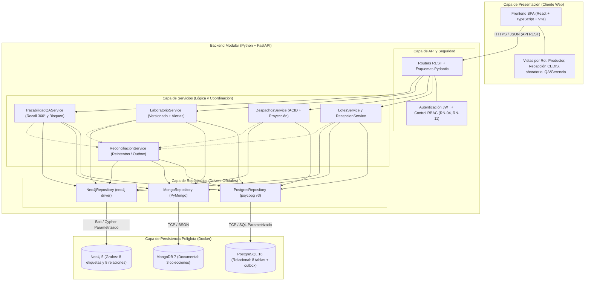
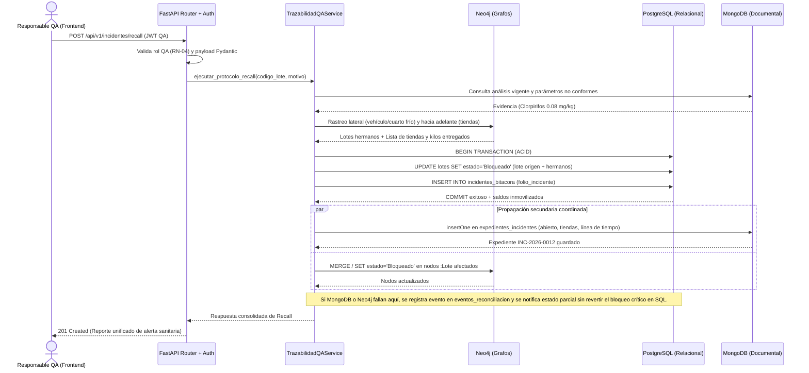

# Arquitectura y Selección Tecnológica: TrazaAgro

Este documento define la arquitectura de software, la selección tecnológica justificada, los contratos de la API y la estrategia de coordinación entre bases de datos para la plataforma **TrazaAgro**. Su diseño responde directamente al dominio modelado en el Entregable 2 (`docs/02-modelado-datos.md`) y garantiza que **PostgreSQL**, **MongoDB** y **Neo4j** operen como una sola aplicación integrada bajo la coordinación del backend.

## 1. Visión General y Principios Arquitectónicos

Para el alcance del proyecto se adopta una **arquitectura monolítica modular en capas** con un backend central que expone una **API REST** hacia una aplicación web SPA (*Single Page Application*). Se descarta una arquitectura de microservicios o transacciones distribuidas (2PC) porque introducirían complejidad operativa innecesaria para el MVP, mientras que una API modular permite coordinar los tres motores con reglas claras, trazabilidad de errores y despliegue reproducible.

Los principios arquitectónicos no negociables de TrazaAgro son:

* **Desacoplamiento total de la interfaz:** El frontend jamás se conecta a PostgreSQL, MongoDB ni Neo4j, ni conoce credenciales o consultas internas. Toda interacción pasa por la API REST.
* **Separación estricta de capas en el backend:** Los controladores (routers) solo validan HTTP, autenticación y contratos de entrada/salida; los servicios aplican las reglas de negocio (`RN-01` a `RN-11`) y orquestan los motores; los repositorios encapsulan exclusivamente las consultas parametrizadas de cada base de datos.
* **Fuente única de verdad:** Ningún dato maestro o contable se modifica libremente en más de un motor. PostgreSQL gobierna el inventario y los estados maestros; MongoDB gobierna los expedientes técnicos inmutables; Neo4j gobierna la red física de recorridos.
* **Reconocimiento explícito de fallos parciales:** Toda operación que escribe en más de una base define un orden de escritura, operaciones idempotentes y un mecanismo de reconciliación para no reportar falsos éxitos.

## 2. Diagrama de Arquitectura de Componentes

El siguiente diagrama muestra los componentes de la solución, sus capas internas, los protocolos de comunicación y la conexión hacia los tres motores de persistencia:



## 3. Responsabilidades por Capa

### Frontend (React + TypeScript + Vite)
* Presenta una experiencia unificada adaptada a los 4 actores del MVP (**Empacadora/Productor**, **Recepción y Almacén en CEDIS**, **Laboratorio Externo** y **QA e Inocuidad / Gerencia**).
* Captura formularios con validación previa de tipos y formatos (por ejemplo, lecturas térmicas en recepción, parámetros variables de laboratorio o kilos a despachar).
* Renderiza vistas integradas como el **Expediente 360° del lote** y la **Consola de Retiro (Recall)** con visualización interactiva de la red de tiendas y lotes hermanos devuelta por la API.
* Gestiona el token JWT en sesión para enviar encabezados de autorización; nunca accede directamente a los motores de base de datos ni ejecuta reglas críticas de inventario por su cuenta.

### Capa de API y Seguridad (FastAPI Routers + Pydantic + RBAC)
* Expone los contratos REST en JSON y genera automáticamente la especificación OpenAPI 3.1 y documentación interactiva (Swagger UI / ReDoc).
* Valida estructura, tipos de datos, rangos y campos obligatorios de cada solicitud mediante modelos **Pydantic v2** antes de invocar la lógica de negocio.
* Aplica autenticación basada en tokens **JWT** y autorización por rol (**RBAC**), asegurando el cumplimiento de `RN-04` (solo QA libera o bloquea lotes) y `RN-11` (cada productor consulta únicamente los lotes ligados a su `productor_id`).
* Traduce excepciones de dominio y fallos de persistencia en códigos HTTP consistentes (`400`, `401`, `403`, `404`, `409`, `422`, `503`) con mensajes estructurados.

### Capa de Servicios de Aplicación (Coordinación y Reglas de Negocio)
* Es el cerebro integrador del sistema: decide en qué orden se consulta o escribe cada motor y aplica las reglas de negocio del dominio (`RN-01` a `RN-11`).
* **Servicios clave:**
  * `LotesService` y `RecepcionService`: crean lotes en PostgreSQL, evalúan la temperatura de llegada (`4.0` a `8.0 °C` según `RN-07`), registran el acta física/sensorial en MongoDB y proyectan nodos y aristas `[:COSECHADO_EN]`, `[:TRASLADADO_EN]` y `[:ALMACENADO_EN]` en Neo4j.
  * `DespachosService`: ejecuta el descuento transaccional ACID en PostgreSQL (`RN-01`, `RN-03`) y proyecta las relaciones `[:DIVIDIDO_EN]`, `[:DESPACHADO_EN]` y `[:ENTREGADO_A]` en Neo4j.
  * `LaboratorioService`: valida la existencia del lote en PostgreSQL, gestiona el versionado inmutable en MongoDB (`RN-05`), proyecta `(:Laboratorio)-[:EMITIO_ANALISIS]->(:Lote)` en Neo4j y evalúa la condición de liberación `RN-02` (`(∃ análisis vigente Conforme) ∧ (¬∃ análisis vigente No Conforme)`).
  * `TrazabilidadQAService`: coordina el flujo de **bloqueo atómico y recall** (`RN-08`), consulta en Neo4j tiendas afectadas y lotes hermanos por vehículo o cuarto frío, registra el bloqueo en PostgreSQL, abre o cierra el expediente en `expedientes_incidentes` de MongoDB (`RN-09`) y ensambla la vista consolidada 360°.
  * `ReconciliacionService`: registra y reintenta propagaciones secundarias pendientes hacia Neo4j o MongoDB cuando ocurre una falla parcial posterior al `COMMIT` en PostgreSQL.

### Capa de Repositorios Especializados
* Encapsula el acceso físico a cada motor mediante su driver oficial y **consultas 100% parametrizadas** (sin concatenación de cadenas para prevenir inyección SQL, NoSQL o Cypher).
* **`PostgresRepository`**: gestiona el pool de conexiones y transacciones explícitas (`BEGIN / COMMIT / ROLLBACK`), bloqueos pesimistas (`SELECT ... FOR UPDATE`) y operaciones sobre las 8 tablas maestras más la bitácora técnica de reconciliación.
* **`MongoRepository`**: ejecuta inserciones, consultas `$elemMatch`, actualizaciones controladas de vigencia (`es_vigente: false`) y cierre de expedientes en `analisis_laboratorio`, `actas_recepcion` y `expedientes_incidentes`.
* **`Neo4jRepository`**: ejecuta escrituras idempotentes (`MERGE`) sobre las 8 etiquetas de nodo y 8 tipos de relación, así como los recorridos Cypher de trazabilidad hacia adelante, hacia atrás, lateral y por laboratorio.

## 4. Selección Tecnológica y Matriz de Comparación del Stack

### Resumen del Stack Elegido

| Componente | Tecnología elegida | Versión objetivo | Rol en TrazaAgro |
| :--- | :--- | :--- | :--- |
| **Frontend** | React + TypeScript + Vite | React 18+ / TS 5+ | Interfaz web SPA por rol, formularios validados y vistas de trazabilidad. |
| **Estilos y estado cliente** | Tailwind CSS + TanStack Query | Tailwind 3+ / TQ 5+ | Diseño ágil y caché/sincronización limpia de llamadas a la API REST. |
| **Visualización de grafos** | React Flow o Cytoscape.js | Última estable | Representación visual interactiva de rutas de lote, tiendas y lotes hermanos. |
| **Backend / API** | Python + FastAPI + Uvicorn | Python 3.12+ / FastAPI 0.115+ | API REST, validación Pydantic v2, RBAC, coordinación de los 3 motores y Swagger automático. |
| **Base relacional** | PostgreSQL + `psycopg` (v3) | PostgreSQL 16 | Fuente de verdad ACID, inventario, estados maestros y bitácora de incidentes. |
| **Base documental** | MongoDB + `pymongo` | MongoDB 7 | Certificados polimórficos versionados, actas de recepción y expedientes de recall. |
| **Base de grafos** | Neo4j + `neo4j` Python driver | Neo4j 5 (Community) | Red de distribución física, recorridos N-saltos y detección de contagio lateral. |
| **Pruebas** | `pytest` + `httpx` | Pytest 8+ | Pruebas unitarias, de integración por motor, de consistencia y extremo a extremo. |
| **Contenedores y despliegue** | Docker + Docker Compose | Compose v2 | Orquestación reproducible de las 3 bases, backend y frontend en un solo comando. |

### Matrices de Comparación y Justificación

#### A. Framework de Backend

| Criterio | Python + FastAPI (Elegido) | Node.js + Express / NestJS | Java + Spring Boot |
| :--- | :--- | :--- | :--- |
| **Soporte de drivers oficiales (PG, Mongo, Neo4j)** | Excelente: `psycopg`, `pymongo` y `neo4j` son oficiales, maduros y con sintaxis muy limpia. | Muy bueno (`pg`, `mongodb`, `neo4j-driver`), aunque exige más configuración de tipado manual en Express. | Excelente, pero con mayor sobrecarga de boilerplate para un MVP académico. |
| **Validación de esquemas polimórficos** | Nativa con **Pydantic v2** (uniones discriminadas ideales para análisis químicos vs. microbiológicos). | Requiere librerías externas (Zod, class-validator) con mayor configuración. | Requiere DTOs verbosos y anotaciones extensas para estructuras variables. |
| **Documentación de API (OpenAPI)** | Automática sin esfuerzo extra (`/docs` y `/openapi.json` en vivo). | Requiere configuración manual con Swagger/OpenAPI o decoradores extensos en NestJS. | Requiere dependencias adicionales (`springdoc-openapi`). |
| **Velocidad de desarrollo del MVP** | Muy alta; ideal para enfocarse en la coordinación de las 3 bases y pruebas. | Alta en Express, media en NestJS por su curva de arquitectura. | Media; mayor tiempo de arranque y compilación. |

**Justificación:** FastAPI permite definir contratos estrictos con Pydantic v2 para documentos polimórficos de MongoDB, integra de forma nativa los tres drivers oficiales sin ORM pesados que oculten las transacciones SQL (`FOR UPDATE`) ni el Cypher, y entrega documentación OpenAPI lista para pruebas y demostración.

#### B. Tecnología de Frontend

| Criterio | React + TypeScript + Vite (Elegido) | Next.js (React) | Vue 3 + Vite |
| :--- | :--- | :--- | :--- |
| **Separación limpia Cliente-API** | Total: SPA pura que consume la API REST de FastAPI sin mezclar lógica de servidor. | Incluye capa propia de servidor (SSR/API Routes) que puede confundir la frontera con el backend Python. | Total: SPA limpia y ligera. |
| **Ecosistema para tablas y grafos** | El más amplio (React Flow, Cytoscape wrappers, TanStack Table/Query). | Mismo ecosistema React, pero con complejidad extra de hidratación SSR en librerías de grafos. | Bueno, aunque con menor variedad de componentes listos para visualización de grafos. |
| **Curva de configuración y build** | Muy rápida con Vite y tipado estricto con TypeScript. | Mayor complejidad de enrutamiento y despliegue por SSR. | Muy rápida con Vite. |

**Justificación:** TrazaAgro es una aplicación operativa interna (no un sitio público que dependa de SEO ni SSR). React + TypeScript + Vite ofrece una frontera arquitectónica impecable frente al backend FastAPI y facilita renderizar el grafo de trazabilidad y los expedientes técnicos complejos.

#### C. Estilo de API

| Criterio | API REST + OpenAPI (Elegido) | GraphQL |
| :--- | :--- | :--- |
| **Ajuste a operaciones transaccionales y comandos** | Natural: verbos HTTP claros (`POST /despachos`, `POST /lotes/{codigo}/bloquear`) con códigos de estado estándar (`201`, `409`, `422`). | Orientado a consultas flexibles; los comandos transaccionales complejos requieren mutaciones menos estándar para errores HTTP. |
| **Complejidad de implementación** | Baja y directa con FastAPI; fácil de probar con `pytest`, `httpx`, Postman o Swagger UI. | Alta: exige definir esquema SDL, resolvers, DataLoaders para evitar N+1 y manejo propio de errores. |
| **Control de acceso por rol (RBAC)** | Sencillo por endpoint y dependencias de FastAPI. | Requiere guardias a nivel de campo y resolver. |

**Justificación:** Los flujos de TrazaAgro son operaciones de negocio bien delimitadas (registrar cosecha, recibir camión, despachar kilos, subir análisis, ejecutar recall). REST expresa con mayor claridad las transiciones de estado y los códigos de conflicto (`409 Conflict` ante lote bloqueado o saldo insuficiente).

#### D. Elección de Drivers Directos vs. ORM/ODM Pesados

Para la capa de repositorios se eligen **drivers oficiales directos** (`psycopg` v3 para PostgreSQL, `pymongo` para MongoDB y `neo4j` para Neo4j) en lugar de ORMs/ODMs pesados (como Django ORM o MongoEngine):
* En **PostgreSQL**, permite controlar de manera explícita `BEGIN`, `SELECT ... FOR UPDATE`, `COMMIT` y `ROLLBACK`, manteniendo total visibilidad sobre los scripts SQL del Entregable 4 y el catálogo de consultas del Entregable 5.
* En **MongoDB**, permite aprovechar nativamente `$elemMatch`, índices únicos parciales y documentos polimórficos sin luchar contra esquemas rígidos de un ODM.
* En **Neo4j**, el driver oficial sobre protocolo Bolt ejecuta consultas Cypher parametrizadas de forma directa y eficiente.

## 5. Contratos de API REST

Todos los endpoints siguen el prefijo `/api/v1`, intercambian JSON UTF-8 y requieren encabezado `Authorization: Bearer <token_jwt>` (salvo `/api/v1/auth/login` y `/api/v1/health`).

### Catálogo de Endpoints Principales

| Método y Ruta | Propósito | Roles permitidos | Reglas aplicadas | Motores coordinados |
| :--- | :--- | :--- | :--- | :--- |
| `GET /api/v1/health` | Verifica conectividad activa hacia PostgreSQL, MongoDB y Neo4j. | Público / Interno | — | PostgreSQL + MongoDB + Neo4j |
| `POST /api/v1/auth/login` | Autentica al usuario y emite JWT con rol y `productor_id` (si aplica). | Todos | `RN-04`, `RN-11` | PostgreSQL |
| `POST /api/v1/lotes` | Registra un lote recién cosechado con su parcela y peso inicial. | Empacadora / Productor, QA | `RN-06` | PostgreSQL → Neo4j |
| `GET /api/v1/lotes/{codigo_lote}` | Devuelve el **Expediente 360°** (inventario SQL + actas y análisis vigentes Mongo + rutas Neo4j). | Todos (Productor filtrado por dueño) | `RN-11` | PostgreSQL + MongoDB + Neo4j |
| `POST /api/v1/recepciones` | Registra llegada al CEDIS, evalúa temperatura, guarda acta sensorial/fotos y crea aristas físicas. | Recepción CEDIS | `RN-07` | PostgreSQL → MongoDB → Neo4j |
| `POST /api/v1/analisis` | Carga certificado de laboratorio polimórfico (versión 1 o enmienda `V+1` inmutable). | Laboratorio Externo, QA | `RN-05` | PostgreSQL (valida) → MongoDB → Neo4j |
| `GET /api/v1/analisis/{codigo_lote}` | Consulta análisis vigentes, historial de versiones o parámetros fuera de norma (`conforme=false`). | QA, Laboratorio (propios), Productor (propios) | `RN-05`, `RN-11` | PostgreSQL (autoriza) + MongoDB |
| `PATCH /api/v1/lotes/{codigo_lote}/liberar` | Cambia el estado del lote a `Liberado` tras validar análisis conformes vigentes. | Solo QA / Gerencia | `RN-02`, `RN-04` | MongoDB (valida) → PostgreSQL → Neo4j |
| `POST /api/v1/envios` | Registra despacho fraccionado a tienda descontando `saldo_kg` de uno o varios lotes. | Recepción CEDIS | `RN-01`, `RN-03` | PostgreSQL (ACID) → Neo4j |
| `POST /api/v1/incidentes/recall` | **Flujo integrado:** bloquea lote y lotes hermanos, consulta tiendas afectadas y abre expediente de retiro. | Solo QA / Gerencia | `RN-04`, `RN-08` | Neo4j (rastrea) → PostgreSQL (bloquea) → MongoDB (abre expediente) → Neo4j (sincroniza estados) |
| `PATCH /api/v1/incidentes/{folio}/cerrar` | Cierra expediente de incidente validando causa raíz, acciones correctivas y firmas. | Solo QA / Gerencia | `RN-04`, `RN-09` | MongoDB → PostgreSQL |
| `GET /api/v1/trazabilidad/{codigo_lote}/adelante` | Rastreo *Forward* en N saltos: envíos y tiendas que recibieron producto del lote. | QA / Gerencia | — | Neo4j (+ enriquecimiento SQL opcional) |
| `GET /api/v1/trazabilidad/{codigo_lote}/atras-lateral` | Rastreo *Backward* (parcela/productor) y lateral (lotes hermanos en mismo vehículo o cuarto frío). | QA / Gerencia | `RN-08` | Neo4j |
| `POST /api/v1/admin/reconciliacion/ejecutar` | Reprocesa eventos pendientes en la bitácora de reconciliación tras un fallo parcial. | QA / Gerencia | Consistencia | PostgreSQL → MongoDB / Neo4j |

### Ejemplos de Contratos JSON (Entrada y Salida)

#### Contrato 1: Despacho Fraccionado (`POST /api/v1/envios`)

Solicitud:
```json
{
  "codigo_envio": "ENV-2026-1052",
  "tienda_id": 42,
  "placas_vehiculo": "JAL-519-M",
  "nombre_chofer": "Miguel Ángel Torres",
  "detalles": [
    {
      "codigo_lote": "AGU-P014-260312-01",
      "cantidad_kg": 250.0
    }
  ]
}
```

Respuesta exitosa (`201 Created`):
```json
{
  "codigo_envio": "ENV-2026-1052",
  "estado_envio": "Preparado",
  "tienda_id": 42,
  "total_kg": 250.0,
  "saldos_actualizados": [
    {
      "codigo_lote": "AGU-P014-260312-01",
      "saldo_kg_restante": 1750.0
    }
  ],
  "sincronizacion": {
    "neo4j": "sincronizado"
  }
}
```

Respuesta de error por regla de negocio (`409 Conflict`, cumpliendo `RN-01` o `RN-03`):
```json
{
  "error": "LOTE_NO_DISPONIBLE_PARA_DESPACHO",
  "mensaje": "El lote AGU-P014-260312-01 se encuentra en estado 'Bloqueado' y no puede despacharse (RN-01).",
  "codigo_lote": "AGU-P014-260312-01"
}
```

#### Contrato 2: Flujo Integrado de Bloqueo y Alerta de Retiro (`POST /api/v1/incidentes/recall`)

Solicitud:
```json
{
  "codigo_lote_origen": "AGU-P014-260312-01",
  "motivo": "Detección de Clorpirifos (0.08 mg/kg) superior al LMR (0.01 mg/kg) en LAB-2026-AGU-0842-V1",
  "incluir_lotes_hermanos": true,
  "ventana_dias_contaminacion": 1
}
```

Respuesta consolidada (`201 Created`):
```json
{
  "folio_incidente": "INC-2026-0012",
  "lote_origen": {
    "codigo_lote": "AGU-P014-260312-01",
    "estado_actual": "Bloqueado",
    "saldo_inmovilizado_kg": 1100.0
  },
  "evidencia_documental": {
    "folio_analisis": "LAB-2026-AGU-0842-V1",
    "laboratorio": "Lab AgroBio S.A. de C.V.",
    "parametros_infractores": [
      { "molecula": "Clorpirifos", "resultado_mg_kg": 0.08, "limite_maximo_mg_kg": 0.01 }
    ]
  },
  "lotes_hermanos_bloqueados": [
    { "codigo_lote": "AGU-P014-260312-02", "causa_vinculo": "Vehículo MICH-842-K" }
  ],
  "tiendas_afectadas": [
    {
      "codigo_sucursal": "SUC-MTY-04",
      "nombre_comercial": "Supermercados del Norte - Valle",
      "codigo_envio": "ENV-2026-1052",
      "cantidad_kg": 450.0
    }
  ],
  "sincronizacion": {
    "postgresql": "confirmado",
    "mongodb": "expediente_creado",
    "neo4j": "estados_actualizados"
  }
}
```

## 6. Flujos de Integración entre los Tres Motores

### Flujo Integrado 1: Bloqueo de Emergencia y Alerta de Retiro (Recall)

Este diagrama de secuencia ilustra cómo el backend coordina las tres bases ante una contingencia sanitaria en un solo llamado desde la interfaz web:



### Flujo Integrado 2: Consulta de Expediente 360° (`GET /api/v1/lotes/{codigo_lote}`)

1. La API valida el JWT; si el usuario es **Productor**, verifica que el lote pertenezca a su `productor_id` (`RN-11`).
2. `TrazabilidadQAService` consulta en **PostgreSQL** la ficha maestra del lote, parcela, productor, saldo actual en kilogramos, recepción oficial y bitácora de incidentes.
3. Consulta en **MongoDB** el acta de recepción (`actas_recepcion`), los análisis de laboratorio vigentes e historial (`analisis_laboratorio`) y, si existen incidentes, sus carpetas en `expedientes_incidentes`.
4. Consulta en **Neo4j** las conexiones físicas del lote (vehículos, cuarto frío, laboratorio emisor y envíos hacia tiendas).
5. El servicio consolida los resultados en un único objeto JSON, tolerando elegantemente datos aún inexistentes (por ejemplo, un lote recién `Cosechado` todavía sin acta de recepción ni envíos) y devolviendo una sola vista coherente al frontend.

## 7. Fuente de Verdad, Sincronización y Manejo de Consistencia

### Matriz de Propiedad de Datos (Fuente de Verdad)

Alineada al 100% con el diccionario de datos del Entregable 2 (`docs/02-modelado-datos.md`):

| Entidad o grupo de datos | Fuente de verdad | Qué se replica o referencia en otros motores | Mecanismo de sincronización |
| :--- | :--- | :--- | :--- |
| **Productores, Parcelas y Tiendas** | **PostgreSQL** (`productores`, `parcelas`, `tiendas`) | En **Neo4j** se proyectan nodos `:Productor`, `:Parcela` y `:Tienda` con sus llaves (`productor_id`, `rfc`, `parcela_id`, `codigo_senasica`, `tienda_id`, `codigo_sucursal`, `activo`). | Escritura en PostgreSQL seguida de `MERGE` idempotente en Neo4j. |
| **Lotes e Inventario** | **PostgreSQL** (`lotes`: `codigo_lote`, `peso_inicial_kg`, `saldo_kg`, `estado`) | En **MongoDB** se usa `codigo_lote` como referencia lógica. En **Neo4j** se proyecta `(:Lote)` con `estado`, pero **jamás** `saldo_kg`. | Transacción en PostgreSQL primero; al crear o cambiar `estado`, el servicio actualiza `:Lote` en Neo4j. |
| **Recepción en CEDIS (pesaje y temperatura oficial)** | **PostgreSQL** (`recepciones_cedis`: `folio_recepcion`, `peso_recibido_kg`, `temperatura_llegada_c`, `dictamen_recepcion`) | En **MongoDB** (`actas_recepcion`) se enlaza 1:1 por `folio_recepcion` y `codigo_lote`. En **Neo4j** se crean aristas `[:TRASLADADO_EN]` y `[:ALMACENADO_EN]`. | Transacción ACID en PostgreSQL (aplica `RN-07`), luego inserción del acta en MongoDB y `MERGE` de aristas en Neo4j. |
| **Actas físicas, evaluación sensorial y fotos** | **MongoDB** (`actas_recepcion`) | No se replica a otros motores. | Escritura directa en MongoDB tras validar existencia de `folio_recepcion` y `codigo_lote` en PostgreSQL. |
| **Certificados y análisis de laboratorio** | **MongoDB** (`analisis_laboratorio`) | En **Neo4j** se proyecta únicamente la arista ligera `(:Laboratorio)-[:EMITIO_ANALISIS]->(:Lote)` con `folio_analisis`, `tipo_estudio`, `dictamen_general` y `es_vigente`. | Validación de `codigo_lote` en PostgreSQL → versionado inmutable en MongoDB (`RN-05`) → `MERGE` de `:Laboratorio` y arista en Neo4j. |
| **Envíos y fraccionamiento de inventario** | **PostgreSQL** (`envios`, `envios_detalle`) | En **Neo4j** se proyectan `:Envio`, `[:DIVIDIDO_EN {cantidad_kg}]`, `[:DESPACHADO_EN]` y `[:ENTREGADO_A]`. | Transacción ACID con `SELECT ... FOR UPDATE` en PostgreSQL (`RN-01`, `RN-03`); tras `COMMIT`, proyección en Neo4j. |
| **Vehículos y Cuartos Fríos** | **Neo4j** (`:Vehiculo`, `:CuartoFrio` como nodos de conectividad) | **PostgreSQL** conserva sus identificadores operativos (`placas_vehiculo`, `codigo_cuarto_frio`) en `recepciones_cedis` y `envios`. | Se crean o actualizan con `MERGE` en Neo4j al registrar recepciones y envíos. |
| **Bitácora de incidentes y transiciones QA** | **PostgreSQL** (`incidentes_bitacora`: `folio_incidente`, `estado_previo`, `nuevo_estado`) | En **MongoDB** (`expedientes_incidentes`) se extiende 1:1 por `folio_incidente`. En **Neo4j** se actualiza `estado` en `:Lote`. | Transacción ACID en PostgreSQL primero; luego creación del expediente en MongoDB y actualización de `:Lote` en Neo4j. |
| **Expedientes de retiro (causa raíz, acciones, firmas)** | **MongoDB** (`expedientes_incidentes`) | No se replica; se referencia 1:1 por `folio_incidente`. | Actualización validada por `$jsonSchema` y `RN-09` en MongoDB. |

### Estrategia de Consistencia y Mecanismo ante Fallos Parciales

Dado que una operación integrada puede escribir en dos o tres motores distintos sin un coordinador 2PC distribuido, TrazaAgro aplica **consistencia eventual coordinada con patrón Outbox ligero**:

1. **Orden estricto de escritura (PostgreSQL manda):**
   * En operaciones que alteran inventario, estados o entidades maestras, la transacción ACID en PostgreSQL siempre se ejecuta primero.
   * Si PostgreSQL rechaza la operación (por ejemplo, saldo insuficiente, lote bloqueado o llave duplicada), se hace `ROLLBACK` inmediato y no se toca ni MongoDB ni Neo4j.
2. **Validación previa para documentos en MongoDB:**
   * Antes de insertar en `analisis_laboratorio` o `actas_recepcion`, el servicio verifica en PostgreSQL que `codigo_lote` (y `folio_recepcion`) exista, evitando documentos huérfanos.
3. **Idempotencia total en Neo4j y MongoDB:**
   * Todas las escrituras en Neo4j usan `MERGE` por clave única (`codigo_lote`, `codigo_envio`, `placas`, `codigo_cuarto_frio`, `acreditacion_iso`) en lugar de `CREATE` ciego.
   * Las inserciones en MongoDB usan llaves únicas (`folio_analisis`, `folio_recepcion`, `folio_incidente`). Así, cualquier reintento posterior produce el mismo estado final sin duplicar datos.
4. **Bitácora de reconciliación (`eventos_reconciliacion` en PostgreSQL):**
   * Se incorpora una tabla técnica de soporte de arquitectura (`eventos_reconciliacion`, separada de las 8 tablas de negocio) con columnas: `evento_id`, `destino_motor` (`mongodb` o `neo4j`), `tipo_operacion`, `llave_entidad`, `payload_json`, `estado` (`PENDIENTE`, `PROCESADO`, `ERROR`), `intentos`, `ultimo_error` y `fecha_creacion`.
   * **¿Qué pasa si PostgreSQL hace `COMMIT` y falla Neo4j o MongoDB?**
     * **Nunca se reporta éxito completo engañoso.** El servicio realiza un reintento inmediato breve (con *backoff* corto).
     * Si el motor secundario sigue caído, el servicio guarda el evento pendiente en `eventos_reconciliacion` y responde al cliente con estado transparente (`201 Created` o `202 Accepted` con bandera `"sincronizacion": { "neo4j": "pendiente_reconciliacion" }` y advertencia clara en UI).
     * En el caso de un **bloqueo de emergencia**, el lote ya queda inmovilizado en PostgreSQL (evitando despachos inmediatamente por `RN-01`), y cuando Neo4j o MongoDB se recuperan, `ReconciliacionService` (ejecutado periódicamente o vía `POST /api/v1/admin/reconciliacion/ejecutar`) aplica los eventos pendientes de forma idempotente hasta que las tres bases convergen.
5. **Compensación controlada cuando aplique:**
   * En flujos donde el documento en MongoDB es indispensable para continuar una transacción no crítica (por ejemplo, carga de análisis donde falla MongoDB antes de proyectar a Neo4j), simplemente se aborta la operación y se devuelve `503 Service Unavailable` sin haber modificado los demás motores.

## 8. Estructura del Repositorio y Entorno de Despliegue

Siguiendo la organización recomendada en la guía oficial del proyecto, el repositorio de TrazaAgro adoptará esta estructura modular para los siguientes entregables:

```text
proyecto-final/
├── docs/
│   ├── 01-propuesta.md
│   ├── 02-modelado-datos.md
│   ├── 03-arquitectura.md
│   ├── decisiones/
│   ├── guia-proyecto/
│   └── requerimientos/
├── database/
│   ├── relational/          # Scripts DDL, datos semilla y consultas PostgreSQL
│   ├── document/            # Validadores $jsonSchema, carga y consultas MongoDB
│   └── graph/               # Constraints, carga y consultas Cypher para Neo4j
├── backend/
│   ├── app/
│   │   ├── api/             # Routers FastAPI, dependencias JWT/RBAC y schemas Pydantic
│   │   ├── services/        # Servicios coordinadores y ReconciliacionService
│   │   ├── repositories/    # relational/, document/ y graph/
│   │   └── core/            # Configuración por variables de entorno y pools de conexión
│   ├── Dockerfile
│   └── requirements.txt
├── frontend/
│   ├── src/
│   │   ├── api/             # Cliente HTTP hacia FastAPI
│   │   ├── pages/           # Vistas por rol, Expediente 360° y Consola Recall
│   │   └── components/      # Formularios, tablas y visor de grafo
│   ├── Dockerfile
│   └── package.json
├── tests/
│   ├── unit/
│   ├── integration/         # Pruebas por motor y de reconciliación ante fallos parciales
│   └── e2e/                 # Flujo completo cosecha -> recepción -> análisis -> despacho -> recall
├── .env.example             # Plantilla de variables sin credenciales reales
├── docker-compose.yml       # Servicios: postgres, mongo, neo4j, backend, frontend
└── README.md
```

Todas las credenciales de conexión (`POSTGRES_URI`, `MONGO_URI`, `NEO4J_URI`, `NEO4J_USER`, `NEO4J_PASSWORD`, `JWT_SECRET_KEY`) se inyectarán exclusivamente mediante variables de entorno externas documentadas en `.env.example`, evitando cualquier credencial fija en el código fuente.
