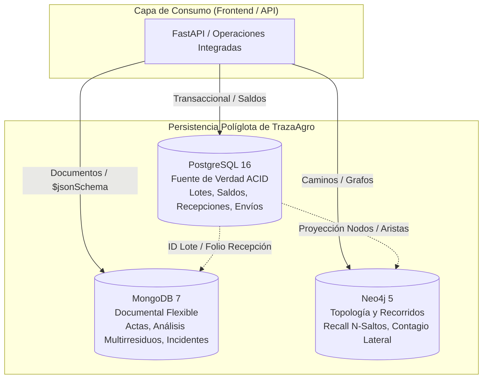
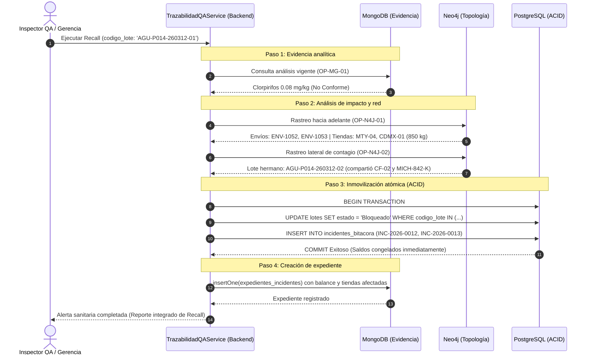

# Catálogo de Operaciones y Consultas: TrazaAgro

Este documento constituye el **Entregable 5** del proyecto integrador **TrazaAgro**. Presenta el catálogo exhaustivo de operaciones del sistema de trazabilidad de alimentos frescos, cubriendo consultas funcionales individuales en cada uno de los tres paradigmas de persistencia (**PostgreSQL 16**, **MongoDB 7** y **Neo4j 5**) y operaciones integradas multimotor.

Todas las consultas y pruebas aquí documentadas fueron ejecutadas directamente sobre el entorno oficial de contenedores Docker del proyecto (`trazaagro-postgres`, `trazaagro-mongo` y `trazaagro-neo4j`), utilizando los datos semilla reproducibles generados en el Entregable 4.



## Resumen del Catálogo de Operaciones

| Identificador | Nombre / Propósito | Motor(es) | Reglas / Candados |
| :--- | :--- | :--- | :--- |
| **OP-PG-01** | Consulta de inventario disponible para despacho | PostgreSQL | `RN-01`, `RN-03` |
| **OP-PG-02** | Auditoría preventiva de cadena de frío en CEDIS | PostgreSQL | `RN-07` |
| **OP-PG-03** | Cuadre contable y conciliación de saldos por lote | PostgreSQL | `RN-03`, `RN-10` |
| **OP-PG-04** | Bloqueo transaccional de lote e inmovilización de inventario | PostgreSQL | `RN-01`, `RN-04`, ACID |
| **OP-MG-01** | Detección de plaguicidas fuera de LMR (`$elemMatch`) | MongoDB | NOM / EPA LMR |
| **OP-MG-02** | Auditoría de trazabilidad e historial de versiones | MongoDB | `RN-05` (Inmutabilidad) |
| **OP-MG-03** | Acta física de recepción y perfil térmico de tarimas | MongoDB | `RN-07`, `$jsonSchema` |
| **OP-MG-04** | Balance de efectividad de retiro en incidentes sanitarios | MongoDB | `RN-09` (Recall cerrado) |
| **OP-N4J-01** | Rastreo hacia adelante: impacto y distribución en tiendas | Neo4j | Recall N-Saltos |
| **OP-N4J-02** | Rastreo lateral: detección de contaminación cruzada | Neo4j | `RN-08` (Recurso compartido) |
| **OP-N4J-03** | Auditoría de integridad topológica y cardinalidades | Neo4j | `RN-06` (1:1 Lote-Parcela) |
| **OP-INT-01** | Protocolo integrado de Recall y Alerta Sanitaria | PG + N4J + MG | `RN-01`, `RN-04`, `RN-08`, `RN-09` |
| **OP-INT-02** | Consulta de Expediente Unificado 360° del Lote | PG + MG + N4J | Fusión políglota |

## 1. Operaciones en Base Relacional (PostgreSQL 16)

PostgreSQL funge como la **fuente de verdad contable y de estados**. Sus operaciones garantizan atomicidad, consistencia y aislamiento estricto en saldos de inventario y cambios de estado maestro.

### OP-PG-01: Consulta de inventario disponible para despacho

* **Propósito:** Listar únicamente aquellos lotes que cuentan con autorización sanitaria (`estado = 'Liberado'`) y tienen existencia física positiva (`saldo_kg > 0`), ordenados por fecha de cosecha (FIFO) para su asignación a rutas de transporte.
* **Bases que intervienen:** PostgreSQL (`lotes`, `parcelas`, `productores` a través de la vista `v_lotes_listos_despacho`).
* **Parámetros de entrada y validaciones:** Ninguno (consulta de catálogo). Aplica las reglas `RN-01` (solo despachar fruta liberada) y `RN-03` (saldo estrictamente positivo).
* **Sentencia SQL:**

```sql
SELECT
    codigo_lote,
    producto,
    peso_inicial_kg,
    saldo_kg,
    nombre_huerta,
    productor
FROM v_lotes_listos_despacho
ORDER BY fecha_cosecha ASC;
```

* **Resultado esperado:** Conjunto tabular donde ningún registro tenga `saldo_kg <= 0` ni estado diferente a `'Liberado'`.
* **Casos considerados:**
  * *Caso normal:* Lotes liberados con inventario remanente listo para programar envíos.
  * *Caso límite:* Lote con `saldo_kg = 0.00` (agotado) o lote con `estado = 'Bloqueado'` (no debe figurar).
* **Evidencia de ejecución real (psql en contenedor `trazaagro-postgres`):**

```text
    codigo_lote     |   producto    | peso_inicial_kg | saldo_kg |  nombre_huerta   |             productor              
--------------------+---------------+-----------------+----------+------------------+------------------------------------
 AGU-P018-260314-01 | Aguacate Hass |         3000.00 |  2050.00 | Huerta Los Pinos | Huertas del Tancítaro S.A. de C.V.
 AGU-P018-260316-01 | Aguacate Hass |         2200.00 |  2000.00 | Huerta Los Pinos | Huertas del Tancítaro S.A. de C.V.
(2 rows)
```

### OP-PG-02: Auditoría preventiva de cadena de frío en CEDIS

* **Propósito:** Identificar recepciones de fruta en las que la temperatura de llegada violó el umbral biológico y normativo de conservación (rango permitido de 4.0 a 8.0 °C según regla `RN-07`), para verificar que el lote haya sido retenido en cuarentena.
* **Bases que intervienen:** PostgreSQL (`recepciones_cedis`, `lotes` mediante la vista `v_auditoria_cadena_frio`).
* **Parámetros de entrada y validaciones:** Condición `temperatura_llegada_c < 4.0 OR temperatura_llegada_c > 8.0`.
* **Sentencia SQL:**

```sql
SELECT
    codigo_lote,
    folio_recepcion,
    temperatura_llegada_c,
    dictamen_recepcion,
    estado_lote,
    placas_vehiculo,
    codigo_cuarto_frio
FROM v_auditoria_cadena_frio;
```

* **Resultado esperado:** Lista de recepciones no conformes térmicamente. Cada registro debe reflejar `dictamen_recepcion = 'Retenido'` o `estado_lote = 'En revision'`.
* **Casos considerados:**
  * *Caso normal:* Recepciones dentro del rango (4.5 °C a 6.2 °C) no aparecen en la auditoría.
  * *Caso de alerta:* Arribo con 11.4 °C (`REC-2026-0107`), retenido de inmediato en el cuarto frío de cuarentena `CF-03`.
* **Evidencia de ejecución real:**

```text
    codigo_lote     | folio_recepcion | temperatura_llegada_c | dictamen_recepcion | estado_lote | placas_vehiculo | codigo_cuarto_frio 
--------------------+-----------------+-----------------------+--------------------+-------------+-----------------+--------------------
 AGU-P015-260315-01 | REC-2026-0107   |                  11.4 | Retenido           | En revision | JAL-405-C       | CF-03
(1 row)
```

### OP-PG-03: Cuadre contable y conciliación de saldos por lote

* **Propósito:** Auditar la consistencia matemática e integridad referencial del inventario, comprobando que para cada lote se cumpla exactamente la igualdad: $\text{peso\_inicial\_kg} - \text{saldo\_kg} = \sum(\text{envíos activos})$.
* **Bases que intervienen:** PostgreSQL (`lotes`, `envios_detalle`, `envios`).
* **Parámetros de entrada y validaciones:** Valida `chk_lotes_saldo_valido` (`0 <= saldo_kg <= peso_inicial_kg`) y excluye envíos con `estado_envio = 'Cancelado'`.
* **Sentencia SQL:**

```sql
SELECT
    l.codigo_lote,
    l.estado,
    l.peso_inicial_kg AS cosechado_kg,
    l.saldo_kg,
    (l.peso_inicial_kg - l.saldo_kg) AS diferencia_inventario_kg,
    COALESCE(SUM(CASE WHEN e.estado_envio <> 'Cancelado' THEN ed.cantidad_kg ELSE 0 END), 0.00) AS total_despachado_kg,
    (l.peso_inicial_kg - l.saldo_kg) = COALESCE(SUM(CASE WHEN e.estado_envio <> 'Cancelado' THEN ed.cantidad_kg ELSE 0 END), 0.00) AS cuadre_exacto
FROM lotes l
LEFT JOIN envios_detalle ed ON l.lote_id = ed.lote_id
LEFT JOIN envios e ON ed.envio_id = e.envio_id
GROUP BY l.lote_id, l.codigo_lote, l.estado, l.peso_inicial_kg, l.saldo_kg
ORDER BY l.lote_id;
```

* **Resultado esperado:** Todos los lotes del sistema deben arrojar `cuadre_exacto = true`.
* **Casos considerados:**
  * *Lotes sin despachos:* Diferencia = 0.00 kg, total despachado = 0.00 kg $\to$ `true`.
  * *Lotes fraccionados en múltiples envíos:* Suma exacta de partidas $\to$ `true`.
* **Evidencia de ejecución real:**

```text
    codigo_lote     |   estado    | cosechado_kg | saldo_kg | diferencia_inventario_kg | total_despachado_kg | cuadre_exacto 
--------------------+-------------+--------------+----------+--------------------------+---------------------+---------------
 AGU-P014-260312-01 | Bloqueado   |      2000.00 |  1150.00 |                   850.00 |              850.00 | t
 AGU-P014-260312-02 | Bloqueado   |      1500.00 |  1500.00 |                     0.00 |                   0 | t
 AGU-P018-260314-01 | Liberado    |      3000.00 |  2050.00 |                   950.00 |              950.00 | t
 AGU-P015-260315-01 | En revision |      1800.00 |  1800.00 |                     0.00 |                   0 | t
 AGU-P018-260316-01 | Liberado    |      2200.00 |  2000.00 |                   200.00 |              200.00 | t
 AGU-P014-260318-01 | Cosechado   |      1600.00 |  1600.00 |                     0.00 |                   0 | t
(6 rows)
```

### OP-PG-04: Bloqueo transaccional de lote e inmovilización de inventario

* **Propósito:** Demostrar el control de concurrencia y la atomicidad ACID de PostgreSQL al ejecutar un bloqueo preventivo o de emergencia (`RN-01`, `RN-04`). Se bloquea la fila mediante `FOR UPDATE`, se cambia el estado a `'Bloqueado'` y se inserta el evento en `incidentes_bitacora`.
* **Bases que intervienen:** PostgreSQL (`lotes`, `incidentes_bitacora`).
* **Parámetros de entrada:** `p_codigo_lote` (VARCHAR), `p_folio_incidente` (VARCHAR), `p_motivo` (TEXT), `p_usuario` (VARCHAR).
* **Sentencia SQL (Bloque transaccional):**

```sql
BEGIN;
SELECT lote_id, codigo_lote, saldo_kg, estado
FROM lotes
WHERE codigo_lote = 'AGU-P018-260316-01'
FOR UPDATE;

UPDATE lotes
SET estado = 'Bloqueado',
    saldo_kg = saldo_kg - 300.00 -- Simulación de descuento previo
WHERE codigo_lote = 'AGU-P018-260316-01';

INSERT INTO incidentes_bitacora (
    folio_incidente, lote_id, estado_previo, nuevo_estado,
    motivo, usuario_responsable, fecha_evento
) VALUES (
    'INC-2026-TEST-99', 5, 'Liberado', 'Bloqueado',
    'Prueba de inmovilización transaccional de inventario', 'QA Tester', NOW()
);

SELECT codigo_lote, peso_inicial_kg, saldo_kg, estado
FROM lotes
WHERE codigo_lote = 'AGU-P018-260316-01';

ROLLBACK; -- Se revierte para preservar estado de prueba
```

* **Pruebas negativas de integridad relacional ejecutadas en consola:**
  1. *Violación de saldo negativo (`RN-03`):* `UPDATE lotes SET saldo_kg = -10.00` $\to$ Rechazado con error `check_violation: chk_lotes_saldo_valido`.
  2. *Violación de saldo superior a peso inicial:* `UPDATE lotes SET saldo_kg = 5000.00` $\to$ Rechazado con error `check_violation: chk_lotes_saldo_valido`.
  3. *Estado inválido:* `UPDATE lotes SET estado = 'Vendido'` $\to$ Rechazado con error `chk_lotes_estado_valido`.
  4. *Borrado físico prohibido (`RN-10`):* `DELETE FROM lotes WHERE lote_id = 1` $\to$ Rechazado con error `foreign_key_violation: fk_recepciones_lote` (ON DELETE RESTRICT).

## 2. Operaciones en Base Documental (MongoDB 7)

MongoDB almacena los **expedientes técnicos heterogéneos, polimórficos y anidados** (análisis químicos/microbiológicos, actas físicas y expedientes de recall).

### OP-MG-01: Detección de plaguicidas fuera de límite máximo (`$elemMatch`)

* **Propósito:** Localizar de forma inmediata cualquier certificado de laboratorio vigente que contenga determinaciones químicas fuera de norma (`conforme: false`), extrayendo la molécula contaminante, el método analítico y el exceso registrado para activar la alerta sanitaria.
* **Bases que intervienen:** MongoDB (Colección `analisis_laboratorio`).
* **Filtros y proyecciones:** `es_vigente: true`, `muestras.determinaciones.conforme: false`.
* **Script mongosh:**

```javascript
db.analisis_laboratorio.find(
  {
    es_vigente: true,
    muestras: {
      $elemMatch: {
        determinaciones: {
          $elemMatch: { conforme: false }
        }
      }
    }
  },
  {
    _id: 0,
    folio_analisis: 1,
    codigo_lote: 1,
    tipo_estudio: 1,
    dictamen_general: 1,
    "laboratorio.nombre": 1,
    "muestras.determinaciones": 1
  }
).toArray();
```

* **Resultado esperado:** Documento JSON del lote `AGU-P014-260312-01` evidenciando presencia de Clorpirifos a 0.08 mg/kg (LMR permitido: 0.01 mg/kg).
* **Evidencia de ejecución real (mongosh en `trazaagro-mongo`):**

```json
[
  {
    "folio_analisis": "LAB-2026-AGU-0842-V1",
    "codigo_lote": "AGU-P014-260312-01",
    "tipo_estudio": "Residuos de Plaguicidas",
    "dictamen_general": "No Conforme",
    "laboratorio": {
      "nombre": "Lab AgroBio S.A. de C.V."
    },
    "muestras": [
      {
        "determinaciones": [
          {
            "molecula": "Clorpirifos",
            "metodo_ensayo": "AOAC 2007.01 (QuEChERS / GC-MS/MS)",
            "resultado_mg_kg": 0.08,
            "unidad": "mg/kg",
            "limite_maximo_mg_kg": 0.01,
            "conforme": false
          },
          {
            "molecula": "Malation",
            "metodo_ensayo": "AOAC 2007.01 (QuEChERS / GC-MS/MS)",
            "resultado_mg_kg": 0.002,
            "unidad": "mg/kg",
            "limite_maximo_mg_kg": 0.05,
            "conforme": true
          }
        ]
      }
    ]
  }
]
```

### OP-MG-02: Auditoría de trazabilidad e historial inmutable de versiones (`RN-05`)

* **Propósito:** Recuperar la secuencia completa de certificados emitidos para un mismo lote y estudio, verificando que las versiones anteriores no se sobreescriban físicamente (inmutabilidad), sino que se vinculen mediante `folio_reemplazado` y `motivo_enmienda`.
* **Bases que intervienen:** MongoDB (Colección `analisis_laboratorio`).
* **Filtros:** `codigo_lote: "AGU-P018-260314-01"`, `tipo_estudio: "Residuos de Plaguicidas"`, ordenado por `version: -1`.
* **Script mongosh:**

```javascript
db.analisis_laboratorio.find(
  {
    codigo_lote: "AGU-P018-260314-01",
    tipo_estudio: "Residuos de Plaguicidas"
  },
  {
    _id: 0,
    folio_analisis: 1,
    version: 1,
    es_vigente: 1,
    dictamen_general: 1,
    folio_reemplazado: 1,
    motivo_enmienda: 1
  }
).sort({ version: -1 }).toArray();
```

* **Resultado esperado:** Dos documentos vinculados. La V2 activa (`es_vigente: true`, `Conforme`) y la V1 histórica (`es_vigente: false`, `No Conforme`).
* **Evidencia de ejecución real:**

```json
[
  {
    "folio_analisis": "LAB-2026-AGU-0910-V2",
    "version": 2,
    "es_vigente": true,
    "folio_reemplazado": "LAB-2026-AGU-0910-V1",
    "motivo_enmienda": "Reanálisis de contramuestra M-01B por ajuste de curva de calibración en detector MS/MS.",
    "dictamen_general": "Conforme"
  },
  {
    "folio_analisis": "LAB-2026-AGU-0910-V1",
    "version": 1,
    "es_vigente": false,
    "folio_reemplazado": null,
    "motivo_enmienda": null,
    "dictamen_general": "No Conforme"
  }
]
```

### OP-MG-03: Consulta de acta física de recepción y perfil térmico

* **Propósito:** Consultar el acta de recepción en CEDIS de un lote que sufrió estrés térmico, inspeccionando la matriz de temperaturas registradas por tarima y los defectos visuales detectados por el inspector.
* **Bases que intervienen:** MongoDB (Colección `actas_recepcion`).
* **Filtros:** `folio_recepcion: "REC-2026-0107"`.
* **Script mongosh:**

```javascript
db.actas_recepcion.findOne(
  { folio_recepcion: "REC-2026-0107" },
  {
    _id: 0,
    folio_recepcion: 1,
    codigo_lote: 1,
    "inspector.nombre": 1,
    defectos_detectados: 1,
    monitoreo_temperatura_caja: 1,
    observaciones_inspector: 1
  }
);
```

* **Evidencia de ejecución real:**

```json
{
  "folio_recepcion": "REC-2026-0107",
  "codigo_lote": "AGU-P015-260315-01",
  "inspector": {
    "nombre": "Carlos Mendoza"
  },
  "defectos_detectados": [
    {
      "tipo_defecto": "Ablandamiento prematuro por estrés térmico",
      "severidad": "Moderada",
      "porcentaje_afectado": 14.5
    }
  ],
  "monitoreo_temperatura_caja": [
    { "zona_contenedor": "Frente (cerca de difusor)", "tarima": "T-01", "temperatura_c": 10.8 },
    { "zona_contenedor": "Centro", "tarima": "T-04", "temperatura_c": 11.4 },
    { "zona_contenedor": "Fondo (puertas)", "tarima": "T-07", "temperatura_c": 12.1 }
  ],
  "observaciones_inspector": "ALERTA RN-07: Ruptura de cadena de frío (11.4 °C promedio). Lote retenido en cuarentena CF-03 para dictamen de QA."
}
```

### OP-MG-04: Balance de efectividad de retiro en incidentes sanitarios

* **Propósito:** Calcular mediante agregación el porcentaje de recuperación física de producto en un expediente de Recall cerrado (`RN-09`), contrastando los kilogramos despachados contra los recuperados en anaquel.
* **Bases que intervienen:** MongoDB (Colección `expedientes_incidentes`).
* **Pipeline de agregación:**

```javascript
db.expedientes_incidentes.aggregate([
  { $match: { folio_incidente: "INC-2026-0012" } },
  {
    $project: {
      _id: 0,
      folio_incidente: 1,
      estado_expediente: 1,
      total_enviado_kg: "$balance_producto.total_despachado_kg",
      total_retirado_kg: "$balance_producto.total_recuperado_kg",
      sucursales_notificadas: { $size: "$sucursales_afectadas" },
      porcentaje_recuperacion: {
        $round: [
          {
            $multiply: [
              { $divide: ["$balance_producto.total_recuperado_kg", "$balance_producto.total_despachado_kg"] },
              100
            ]
          },
          2
        ]
      }
    }
  }
]).toArray();
```

* **Evidencia de ejecución real:**

```json
[
  {
    "folio_incidente": "INC-2026-0012",
    "estado_expediente": "Cerrado",
    "total_enviado_kg": 850,
    "total_retirado_kg": 795,
    "sucursales_notificadas": 2,
    "porcentaje_recuperacion": 93.53
  }
]
```

* **Pruebas de candados `$jsonSchema` en MongoDB:**
  * *Intento de doble versión vigente:* Insertar un segundo documento con `es_vigente: true` para el mismo lote y estudio fue rechazado por índice parcial único con código de error `11000 (DuplicateKey)`.
  * *Cierre sin causa raíz (`RN-09`):* Intentar actualizar un expediente a `'Cerrado'` sin `causa_raiz` o sin `firmas_cierre` fue rechazado por el validador con código `121 (DocumentValidationFailure)`.

## 3. Operaciones en Base de Grafos (Neo4j 5)

Neo4j modela la **red viva de distribución física**, permitiendo traversals recursivos en $N$-saltos y detección de contagio lateral imposibles de resolver eficientemente en motores relacionales.

### OP-N4J-01: Rastreo hacia adelante: impacto y distribución en tiendas (Recall)

* **Propósito:** Ante un lote contaminado, recorrer en profundidad la topología de la cadena de suministro para identificar todos los envíos despachados, vehículos de reparto utilizados, tiendas receptoras y volumen entregado en anaquel.
* **Bases que intervienen:** Neo4j (Nodos `:Lote`, `:Envio`, `:Vehiculo`, `:Tienda`).
* **Consulta Cypher:**

```cypher
MATCH (l:Lote {codigo_lote: 'AGU-P014-260312-01'})-[div:DIVIDIDO_EN]->(e:Envio)
MATCH (e)-[:DESPACHADO_EN]->(v:Vehiculo)
MATCH (e)-[:ENTREGADO_A]->(t:Tienda)
RETURN
    l.codigo_lote AS lote_origen,
    l.estado AS estado_lote,
    e.codigo_envio AS envio,
    e.estado_envio AS estado_envio,
    v.placas AS unidad_reparto,
    t.codigo_sucursal AS sucursal,
    t.nombre_comercial AS tienda,
    t.ciudad AS ciudad,
    div.cantidad_kg AS kg_entregados
ORDER BY e.fecha_despacho ASC;
```

* **Resultado esperado:** Identificación inmediata de las dos tiendas comprometidas (en Monterrey y CDMX), las unidades de transporte asignadas y los 850 kg totales distribuidos.
* **Evidencia de ejecución real (cypher-shell en `trazaagro-neo4j`):**

```text
lote_origen, estado_lote, envio, estado_envio, unidad_reparto, sucursal, tienda, ciudad, kg_entregados
"AGU-P014-260312-01", "Bloqueado", "ENV-2026-1052", "Entregado", "TRK-884-A", "SUC-MTY-04", "Supermercados del Norte - Valle", "Monterrey, N.L.", 450.0
"AGU-P014-260312-01", "Bloqueado", "ENV-2026-1053", "Entregado", "TRK-902-C", "SUC-CDMX-01", "Selecto Chedraui - Polanco", "Ciudad de México", 400.0
```

### OP-N4J-02: Rastreo lateral: detección de contaminación cruzada (`RN-08`)

* **Propósito:** Detectar "lotes hermanos" que compartieron infraestructura crítica (mismo camión de traslado desde campo o misma cámara de refrigeración en CEDIS) con un lote declarado no conforme, permitiendo su bloqueo preventivo antes de que salgan a distribución.
* **Bases que intervienen:** Neo4j (Patrón bidireccional entre `:Lote`, `:Vehiculo` y `:CuartoFrio`).
* **Consulta Cypher:**

```cypher
MATCH (contaminado:Lote {codigo_lote: 'AGU-P014-260312-01'})-[r:TRASLADADO_EN|ALMACENADO_EN]->(recurso)<-[r2:TRASLADADO_EN|ALMACENADO_EN]-(sospechoso:Lote)
WHERE contaminado <> sospechoso
RETURN
    contaminado.codigo_lote AS lote_contaminado,
    sospechoso.codigo_lote AS lote_sospechoso,
    sospechoso.estado AS estado_actual_hermano,
    labels(recurso)[0] AS tipo_recurso_compartido,
    coalesce(recurso.placas, recurso.codigo_cuarto_frio) AS identificador_recurso,
    type(r) AS tipo_vinculo;
```

* **Resultado esperado:** Detección de que el lote `AGU-P014-260312-02` compartió tanto el camión de campo `MICH-842-K` como la cámara `CF-02`, justificando su bloqueo preventivo (`INC-2026-0013`).
* **Evidencia de ejecución real:**

```text
lote_contaminado, lote_sospechoso, estado_actual_hermano, tipo_recurso_compartido, identificador_recurso, tipo_vinculo
"AGU-P014-260312-01", "AGU-P014-260312-02", "Bloqueado", "CuartoFrio", "CF-02", "ALMACENADO_EN"
"AGU-P014-260312-01", "AGU-P014-260312-02", "Bloqueado", "Vehiculo", "MICH-842-K", "TRASLADADO_EN"
```

### OP-N4J-03: Auditoría de integridad topológica y cardinalidades (`RN-06`)

* **Propósito:** Validar mediante consulta de grafo que todo nodo `:Lote` en la base de datos cumpla estrictamente la cardinalidad de origen: debe conectarse a exactamente una `:Parcela` y a un `:Productor`.
* **Bases que intervienen:** Neo4j (`:Lote`, `:Parcela`, `:Productor`).
* **Consulta Cypher:**

```cypher
MATCH (l:Lote)
OPTIONAL MATCH (l)-[:COSECHADO_EN]->(pa:Parcela)-[:PERTENECE_A]->(pr:Productor)
WITH l, count(DISTINCT pa) AS num_parcelas, count(DISTINCT pr) AS num_productores
WHERE num_parcelas <> 1 OR num_productores <> 1
RETURN l.codigo_lote AS lote_invalido, num_parcelas, num_productores;
```

* **Resultado esperado:** Cero registros devueltos (ningún lote huérfano ni con orígenes ambiguos).
* **Evidencia de ejecución real:** 0 filas retornadas (verificación de integridad perfecta).

## 4. Operaciones Integradas Multimotor

Estas operaciones demuestran cómo la solución coordina los tres motores para resolver flujos de negocio que ninguno podría resolver de forma aislada.

### OP-INT-01: Protocolo Coordinado de Recall Sanitario y Bloqueo de Emergencia



* **Propósito:** Contener un riesgo sanitario en minutos: extraer la evidencia química en MongoDB, determinar las tiendas afectadas y lotes hermanos en Neo4j, inmovilizar el inventario atómicamente en PostgreSQL y consolidar el expediente formal de retiro.
* **Bases que intervienen:** MongoDB $\to$ Neo4j $\to$ PostgreSQL $\to$ MongoDB.
* **Manejo de inconsistencia y fallos parciales:**
  * Si PostgreSQL falla al bloquear: Se cancela la transacción (`ROLLBACK`) y no se genera expediente.
  * Si Neo4j o MongoDB fallan tras el `COMMIT` en PostgreSQL: El inventario **ya está protegido** en la fuente de verdad (nadie puede venderlo por `RN-01`); el servicio escribe en `eventos_reconciliacion` de PostgreSQL para que el worker de fondo sincronice el estado en el grafo y documento cuando reanuden servicio.

### OP-INT-02: Consulta de Expediente Unificado 360° del Lote

* **Propósito:** Ofrecer en una sola vista del frontend toda la vida útil del producto: datos maestros y saldo contable (PostgreSQL), actas físicas y análisis de laboratorio (MongoDB), y ruta logística con actores de transporte y venta (Neo4j).
* **Parámetros de entrada:** `codigo_lote` (ej. `'AGU-P014-260312-01'`).
* **Coordinación de persistencia:**
  1. *PostgreSQL:* Obtiene estado actual (`'Bloqueado'`), saldo (`1,150.00 kg`), peso inicial (`2,000.00 kg`), huerta (`"Huerta La Escondida"`), registro SENASICA y pesaje oficial en CEDIS (`REC-2026-0104`).
  2. *MongoDB:* Obtiene el acta de recepción firmada con checklist sensorial y los certificados analíticos vigentes (`LAB-2026-AGU-0842-V1` y `LAB-2026-AGU-0845-V1`).
  3. *Neo4j:* Obtiene la unidad de transporte de campo (`MICH-842-K`), el cuarto frío asignado (`CF-02`), los laboratorios involucrados y el historial de despachos a sucursales.
* **Resultado consolidado devuelto por la API (JSON unificado):**

```json
{
  "resumen_lote": {
    "codigo_lote": "AGU-P014-260312-01",
    "estado_maestro": "Bloqueado",
    "inventario": {
      "peso_inicial_kg": 2000.0,
      "saldo_disponible_kg": 1150.0,
      "total_despachado_kg": 850.0
    },
    "origen": {
      "productor": "Aguacateros Unidos de Michoacán S.P.R. de R.L.",
      "huerta": "Huerta La Escondida",
      "registro_senasica": "SENASICA-MICH-URU-014"
    }
  },
  "logistica_cedis": {
    "folio_recepcion": "REC-2026-0104",
    "temperatura_arribo_c": 5.9,
    "dictamen_recepcion": "Conforme",
    "transporte_campo": "MICH-842-K",
    "almacenamiento": "CF-02",
    "inspector_cedis": "Carlos Mendoza"
  },
  "expediente_calidad_laboratorio": [
    {
      "folio": "LAB-2026-AGU-0842-V1",
      "tipo": "Residuos de Plaguicidas",
      "laboratorio": "Lab AgroBio S.A. de C.V.",
      "dictamen": "No Conforme",
      "hallazgos_criticos": [
        { "molecula": "Clorpirifos", "resultado_mg_kg": 0.08, "lmr": 0.01, "conforme": false }
      ]
    },
    {
      "folio": "LAB-2026-AGU-0845-V1",
      "tipo": "Microbiológico",
      "laboratorio": "Centro Analítico Fitosanitario de Occidente S.C.",
      "dictamen": "Conforme"
    }
  ],
  "trazabilidad_despachos": [
    {
      "codigo_envio": "ENV-2026-1052",
      "tienda": "Supermercados del Norte - Valle",
      "ciudad": "Monterrey, N.L.",
      "cantidad_kg": 450.0
    },
    {
      "codigo_envio": "ENV-2026-1053",
      "tienda": "Selecto Chedraui - Polanco",
      "ciudad": "Ciudad de México",
      "cantidad_kg": 400.0
    }
  ]
}
```

## 5. Matriz de Cumplimiento de Reglas del Negocio en las Consultas

Esta tabla sintetiza cómo cada regla de negocio (`RN-01` a `RN-11`) cuenta con consultas de verificación y pruebas automatizadas en los motores:

| Regla | Descripción | Motor Principal | Operación / Mecanismo de Validación |
| :--- | :--- | :--- | :--- |
| **RN-01** | Prohibido despachar fruta sin liberar o bloqueada | PostgreSQL | `OP-PG-01` (`v_lotes_listos_despacho`) y CHECKs transaccionales. |
| **RN-02** | Obligatoriedad de certificados de inocuidad previos | MongoDB / API | `OP-MG-01` y validación de vigencia de análisis. |
| **RN-03** | No negatividad y tope de saldo de inventario | PostgreSQL | `OP-PG-03` y `chk_lotes_saldo_valido` probado en `03_queries_and_tests.sql`. |
| **RN-04** | Bloqueo de emergencia reservado al rol QA | PostgreSQL / API | `OP-PG-04` y bitácora obligatoria en `incidentes_bitacora`. |
| **RN-05** | Inmutabilidad y versionado estricto de análisis | MongoDB | `OP-MG-02` e índice parcial único `uq_analisis_lote_tipo_vigente`. |
| **RN-06** | Cardinalidad estricta 1:1 Lote $\to$ Parcela | Neo4j | `OP-N4J-03` consulta Cypher de verificación de topología. |
| **RN-07** | Rango térmico obligatorio en CEDIS (4 a 8 °C) | PostgreSQL / Mongo | `OP-PG-02` (`v_auditoria_cadena_frio`) y `OP-MG-03` (perfil térmico). |
| **RN-08** | Detección de contaminación cruzada por recursos | Neo4j | `OP-N4J-02` (traversal sobre `:Vehiculo` y `:CuartoFrio`). |
| **RN-09** | Requisitos obligatorios para cierre de recall | MongoDB | `OP-MG-04` y regla condicional en `$jsonSchema`. |
| **RN-10** | Trazabilidad histórica (prohibición de borrado físico) | PostgreSQL | `OP-PG-04` (ON DELETE RESTRICT en llaves foráneas). |
| **RN-11** | Visibilidad y confidencialidad por productor | PostgreSQL / Neo4j | Filtro estricto por `productor_id` en consultas y expedientes. |
