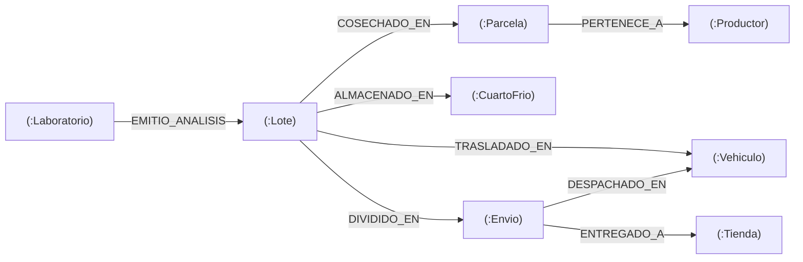

# Decisión de Diseño: Modelo de Grafos en Neo4j

Este documento reúne de forma independiente la especificación de entidades (nodos), relaciones (aristas), propiedades, reglas de conectividad y restricciones para la capa de grafos de **TrazaAgro** en **Neo4j**. Funciona como referencia técnica directa junto con [01-arquitectura-tres-bases.md](file:///c:/Users/Emilia/OneDrive/Documentos/Emilia/UP/DaaS/proyecto-final/docs/decisiones/01-arquitectura-tres-bases.md) y alimenta la Sección 4 de [02-modelado-datos.md](file:///c:/Users/Emilia/OneDrive/Documentos/Emilia/UP/DaaS/proyecto-final/docs/02-modelado-datos.md).

## 1. Enfoque de diseño y decisiones clave

Neo4j modela la **red viva de custodia física, logística y analítica** de la fruta fresca desde la huerta hasta el anaquel. Para evitar redundancias sin propósito y respetar la separación de responsabilidades entre motores, se adoptaron cuatro decisiones de diseño fundamentales:

1. **Separación estricta de fuente de verdad (sin `saldo_kg` en Neo4j):** PostgreSQL conserva la exclusividad contable de `saldo_kg`. El nodo `:Lote` en Neo4j únicamente mantiene una copia de lectura rápida de `estado` (sincronizada desde PostgreSQL) para pintar alertas sanitarias en los recorridos, mientras que los kilos despachados viajan en la propiedad `cantidad_kg` de la relación `[:DIVIDIDO_EN]`.
2. **Nomenclatura técnica unificada:** Todos los nombres de propiedades e identificadores (`codigo_lote`, `codigo_cuarto_frio`, `estado`, `placas`, `codigo_envio`) coinciden exactamente con las columnas de PostgreSQL y referencias de MongoDB para simplificar los repositorios del backend.
3. **Diferenciación explícita de tramos de transporte:** En lugar de reutilizar un mismo verbo ambiguo para todo traslado, el flete de entrada (huerta → CEDIS) se modela como `[:TRASLADADO_EN]` y el reparto de salida (CEDIS → tienda) como `[:DESPACHADO_EN]`.
4. **Inclusión de `:Laboratorio` como nodo ligero:** MongoDB conserva la responsabilidad exclusiva del archivado documental completo (muestras, determinaciones químicas y versiones inmutables), pero Neo4j incorpora el nodo `:Laboratorio` conectado por `[:EMITIO_ANALISIS]` para detectar en un solo salto si un mismo laboratorio aparece vinculado a múltiples lotes afectados o con dictámenes anómalos.

### Casos de uso y recorridos que resuelve el grafo

* **CU-GRF-01 (Rastreo hacia adelante / Recall en N saltos):** Localizar en segundos todas las tiendas y kilogramos exactos que recibieron producto derivado de un lote bloqueado.
* **CU-GRF-02 (Rastreo hacia atrás / Origen agronómico):** Caminar en reversa desde una tienda o envío hasta la parcela exacta, cuadrilla de corte y productor titular.
* **CU-GRF-03 (Detección lateral de contaminación cruzada):** Encontrar lotes hermanos que compartieron el mismo `:Vehiculo` o `:CuartoFrio` en fechas coincidentes para disparar bloqueos preventivos (`RN-08`).
* **CU-GRF-04 (Detección de patrones en laboratorios):** Identificar qué `:Laboratorio` aparece recurrentemente en lotes con alertas sanitarias o enmiendas.

## 2. Diagrama del Modelo de Grafos



## 3. Entidades (Nodos) y Propiedades

Aplicando el principio de modelado en grafos (**si describe al objeto en sí, pertenece al nodo**), se definen **8 etiquetas de nodo**:

### 1. `:Productor`
| Propiedad | Tipo Cypher | Obligatoriedad | Función y valores permitidos |
| :--- | :--- | :--- | :--- |
| `productor_id` | `Integer` | **Obligatoria (UNIQUE)** | Identificador único sincronizado con PK de PostgreSQL. |
| `rfc` | `String` | **Obligatoria (UNIQUE)** | Identificación fiscal única del productor (12-13 caracteres). |
| `nombre_razon_social` | `String` | **Obligatoria** | Nombre legal o comercial del proveedor agrícola. |
| `telefono` | `String` | **Obligatoria** | Teléfono de contacto directo para alertas sanitarias. |
| `activo` | `Boolean` | **Obligatoria** | Valores: `true`, `false`. Controla vigencia operativa sin borrado físico (`RN-10`). |

### 2. `:Parcela`
| Propiedad | Tipo Cypher | Obligatoriedad | Función y valores permitidos |
| :--- | :--- | :--- | :--- |
| `parcela_id` | `Integer` | **Obligatoria (UNIQUE)** | Identificador único sincronizado con PK de PostgreSQL. |
| `codigo_senasica` | `String` | **Obligatoria (UNIQUE)** | Registro fitosanitario oficial ante SENASICA. |
| `nombre_huerta` | `String` | **Obligatoria** | Nombre identificador del predio agrícola. |
| `municipio` | `String` | **Obligatoria** | Ubicación geográfica para cercos sanitarios regionales. |
| `superficie_ha` | `Float` | Opcional | Extensión en hectáreas (`> 0`). |

### 3. `:Lote`
| Propiedad | Tipo Cypher | Obligatoriedad | Función y valores permitidos |
| :--- | :--- | :--- | :--- |
| `codigo_lote` | `String` | **Obligatoria (UNIQUE)** | Llave puente universal entre PostgreSQL, MongoDB y Neo4j (ej. `AGU-P014-260312-01`). |
| `producto` | `String` | **Obligatoria** | Variedad de fruta fresca (ej. `Aguacate Hass`). |
| `fecha_cosecha` | `DateTime` | **Obligatoria** | Momento de recolección en huerta. |
| `peso_inicial_kg` | `Float` | **Obligatoria** | Peso original cosechado (`> 0`). |
| `estado` | `String` | **Obligatoria** | Copia de lectura sincronizada desde PostgreSQL. **Valores permitidos:** `Cosechado`, `Recibido`, `En revision`, `Liberado`, `Bloqueado`, `Retirado`. |

### 4. `:Vehiculo`
| Propiedad | Tipo Cypher | Obligatoriedad | Función y valores permitidos |
| :--- | :--- | :--- | :--- |
| `placas` | `String` | **Obligatoria (UNIQUE)** | Matrícula única de la unidad o caja refrigerada (ej. `MICH-842-K`). |
| `tipo_refrigeracion` | `String` | **Obligatoria** | Tipo de equipo térmico instalado. |
| `temperatura_minima_operativa_c` | `Float` | Opcional | Capacidad mínima de enfriamiento en °C. |

### 5. `:CuartoFrio`
| Propiedad | Tipo Cypher | Obligatoriedad | Función y valores permitidos |
| :--- | :--- | :--- | :--- |
| `codigo_cuarto_frio` | `String` | **Obligatoria (UNIQUE)** | Clave única de la cámara en el CEDIS (ej. `CF-02`). |
| `nombre_cuarto` | `String` | **Obligatoria** | Nombre descriptivo de la cámara de refrigeración. |
| `temperatura_objetivo_c` | `Float` | **Obligatoria** | Temperatura operativa en °C (rango óptimo en cuarto frío para aguacate Hass: `5.0 - 7.0` °C). |
| `capacidad_tarimas` | `Integer` | Opcional | Capacidad física máxima en tarimas (`> 0`). |

### 6. `:Laboratorio`
| Propiedad | Tipo Cypher | Obligatoriedad | Función y valores permitidos |
| :--- | :--- | :--- | :--- |
| `acreditacion_iso` | `String` | **Obligatoria (UNIQUE)** | Clave de acreditación oficial ISO/IEC 17025 (ej. `EMA-ISA-17025-2024`). |
| `nombre` | `String` | **Obligatoria** | Razón social del laboratorio externo emisor. |

### 7. `:Envio`
| Propiedad | Tipo Cypher | Obligatoriedad | Función y valores permitidos |
| :--- | :--- | :--- | :--- |
| `codigo_envio` | `String` | **Obligatoria (UNIQUE)** | Identificador único de la orden de despacho (ej. `ENV-2026-1052`). |
| `fecha_despacho` | `DateTime` | **Obligatoria** | Fecha y hora de salida del CEDIS. |
| `estado_envio` | `String` | **Obligatoria** | **Valores permitidos:** `Preparado`, `En transito`, `Entregado`, `Cancelado`. |

### 8. `:Tienda`
| Propiedad | Tipo Cypher | Obligatoriedad | Función y valores permitidos |
| :--- | :--- | :--- | :--- |
| `tienda_id` | `Integer` | **Obligatoria (UNIQUE)** | Identificador único sincronizado con PK de PostgreSQL. |
| `codigo_sucursal` | `String` | **Obligatoria (UNIQUE)** | Clave comercial única del punto de venta (ej. `SUC-MTY-04`). |
| `nombre_comercial` | `String` | **Obligatoria** | Cadena de supermercados o restaurante receptor. |
| `direccion` | `String` | **Obligatoria** | Domicilio físico de entrega y retiro sanitario. |
| `ciudad` | `String` | **Obligatoria** | Ciudad o zona metropolitana de ubicación. |
| `activo` | `Boolean` | **Obligatoria** | Valores: `true`, `false`. Controla vigencia de sucursal sin borrado físico (`RN-10`). |

## 4. Relaciones (Aristas), Dirección, Cardinalidad y Propiedades

Aplicando el segundo principio (**si describe el evento o la interacción entre dos objetos, pertenece a la relación**), se definen **8 tipos de relación dirigida**:

| Relación (`Origen -[TIPO]-> Destino`) | Cardinalidad | Propiedades de la arista (Tipo y Obligatoriedad) | Función de negocio |
| :--- | :--- | :--- | :--- |
| `(:Parcela)-[:PERTENECE_A]->(:Productor)` | `N : 1` | `fecha_registro` (`Date`, Opcional) | Asocia cada huerta con su productor responsable. |
| `(:Lote)-[:COSECHADO_EN]->(:Parcela)` | `N : 1` | `cuadrilla_cosecha` (`String`, **Obligatoria**)<br>`fecha_cosecha` (`DateTime`, **Obligatoria**) | Identifica origen agronómico exacto y equipo de corte. |
| `(:Lote)-[:TRASLADADO_EN]->(:Vehiculo)` | `N : M` | `folio_recepcion` (`String`, **Obligatoria**)<br>`fecha_llegada` (`DateTime`, **Obligatoria**)<br>`nombre_chofer` (`String`, **Obligatoria**)<br>`peso_recibido_kg` (`Float`, **Obligatoria**, `> 0`)<br>`temperatura_llegada_c` (`Float`, **Obligatoria**) | Registra el traslado huerta → CEDIS y permite detectar lotes que viajaron en la misma caja refrigerada. |
| `(:Lote)-[:ALMACENADO_EN]->(:CuartoFrio)` | `N : M` | `folio_recepcion` (`String`, **Obligatoria**)<br>`fecha_ingreso` (`DateTime`, **Obligatoria**)<br>`fecha_salida` (`DateTime`, Opcional)<br>`dictamen_recepcion` (`String`, **Obligatoria**: `Conforme`, `Retenido`, `Rechazado`) | Registra la ventana temporal de estancia en bodega para detectar contagio cruzado entre tarimas vecinas. |
| `(:Laboratorio)-[:EMITIO_ANALISIS]->(:Lote)` | `N : M` | `folio_analisis` (`String`, **Obligatoria**)<br>`tipo_estudio` (`String`, **Obligatoria**: `Residuos de Plaguicidas`, `Microbiologico`, `Materia Seca`)<br>`dictamen_general` (`String`, **Obligatoria**: `Conforme`, `No Conforme`)<br>`fecha_emision` (`DateTime`, **Obligatoria**)<br>`es_vigente` (`Boolean`, **Obligatoria**) | Proyecta el vínculo ligero del certificado almacenado en MongoDB para descubrir patrones de lotes afectados ligados al mismo laboratorio. |
| `(:Lote)-[:DIVIDIDO_EN]->(:Envio)` | `N : M` | `cantidad_kg` (`Float`, **Obligatoria**, `> 0`) | Representa el fraccionamiento exacto de kilogramos de un lote hacia uno o varios pedidos comerciales. |
| `(:Envio)-[:DESPACHADO_EN]->(:Vehiculo)` | `N : 1` | `fecha_despacho` (`DateTime`, **Obligatoria**)<br>`nombre_chofer` (`String`, Opcional) | Identifica la unidad refrigerada que realizó el reparto del CEDIS a la sucursal. |
| `(:Envio)-[:ENTREGADO_A]->(:Tienda)` | `N : 1` | `fecha_entrega` (`DateTime`, Opcional)<br>`recibido_por` (`String`, Opcional) | Conecta la orden de despacho con el punto de venta final para emisión inmediata de alertas de retiro. |

## 5. Reglas de Conectividad, Restricciones e Índices

### Reglas estructurales de conectividad del negocio

1. **Trazabilidad de origen obligatoria (`RN-06`):** Ningún nodo `:Lote` puede existir huérfano; siempre debe tener exactamente una relación saliente `[:COSECHADO_EN]` hacia una `:Parcela`, y cada `:Parcela` exactamente una relación `[:PERTENECE_A]` hacia un `:Productor`.
2. **Candado sanitario de despacho (`RN-01` y `RN-02`):** La relación `(:Lote)-[:DIVIDIDO_EN]->(:Envio)` solo puede crearse si el `:Lote` posee `estado = 'Liberado'` (respaldado por una relación `[:EMITIO_ANALISIS {es_vigente: true, dictamen_general: 'Conforme'}]`) y la suma de `cantidad_kg` salientes no excede `peso_inicial_kg`.
3. **Secuencia logística obligatoria:** Antes de que un `:Lote` pueda conectarse con un `:Envio`, debe contar con su ingreso formal al CEDIS reflejado en `[:TRASLADADO_EN]` hacia un `:Vehiculo` y `[:ALMACENADO_EN]` hacia un `:CuartoFrio`.
4. **Integridad de despacho:** Todo nodo `:Envio` debe tener al menos una relación entrante `[:DIVIDIDO_EN]` desde uno o más `:Lote`, exactamente una relación `[:DESPACHADO_EN]` hacia un `:Vehiculo` y exactamente una relación `[:ENTREGADO_A]` hacia una `:Tienda`.
5. **Propagación de bloqueos (`RN-08`):** Cuando un `:Lote` pasa a `estado = 'Bloqueado'`, el grafo identifica todos los nodos `:Lote` vecinos (misma `:Parcela` en fecha cercana, mismo `:Vehiculo` vía `[:TRASLADADO_EN]` o mismo `:CuartoFrio` con traslape en `[:ALMACENADO_EN]`) para que el backend ejecute el bloqueo atómico en PostgreSQL y replique el nuevo `estado` en Neo4j.

### Restricciones (`CONSTRAINT`) e Índices (`INDEX`) en Neo4j

Estas definiciones aseguran unicidad de identificadores y arranques de búsqueda instantáneos en la implementación física (Entregable 4):

```cypher
CREATE CONSTRAINT productor_id_unique IF NOT EXISTS FOR (p:Productor) REQUIRE p.productor_id IS UNIQUE;
CREATE CONSTRAINT productor_rfc_unique IF NOT EXISTS FOR (p:Productor) REQUIRE p.rfc IS UNIQUE;
CREATE CONSTRAINT parcela_id_unique IF NOT EXISTS FOR (pa:Parcela) REQUIRE pa.parcela_id IS UNIQUE;
CREATE CONSTRAINT parcela_senasica_unique IF NOT EXISTS FOR (pa:Parcela) REQUIRE pa.codigo_senasica IS UNIQUE;
CREATE CONSTRAINT lote_codigo_unique IF NOT EXISTS FOR (l:Lote) REQUIRE l.codigo_lote IS UNIQUE;
CREATE CONSTRAINT vehiculo_placas_unique IF NOT EXISTS FOR (v:Vehiculo) REQUIRE v.placas IS UNIQUE;
CREATE CONSTRAINT cuarto_codigo_unique IF NOT EXISTS FOR (c:CuartoFrio) REQUIRE c.codigo_cuarto_frio IS UNIQUE;
CREATE CONSTRAINT laboratorio_iso_unique IF NOT EXISTS FOR (lab:Laboratorio) REQUIRE lab.acreditacion_iso IS UNIQUE;
CREATE CONSTRAINT envio_codigo_unique IF NOT EXISTS FOR (e:Envio) REQUIRE e.codigo_envio IS UNIQUE;
CREATE CONSTRAINT tienda_id_unique IF NOT EXISTS FOR (t:Tienda) REQUIRE t.tienda_id IS UNIQUE;
CREATE CONSTRAINT tienda_sucursal_unique IF NOT EXISTS FOR (t:Tienda) REQUIRE t.codigo_sucursal IS UNIQUE;

CREATE INDEX lote_estado_idx IF NOT EXISTS FOR (l:Lote) ON (l.estado);
CREATE INDEX tienda_ciudad_idx IF NOT EXISTS FOR (t:Tienda) ON (t.ciudad);
```

### Sincronización con PostgreSQL y MongoDB

* **Desde PostgreSQL:** El servicio coordinador del backend utiliza operaciones `MERGE` idempotentes para proyectar altas de entidades y despachos hacia Neo4j, y actualiza `l.estado` en `:Lote` cada vez que QA registra una transición en `lotes` e `incidentes_bitacora`.
* **Desde MongoDB:** Al insertar un certificado en `analisis_laboratorio`, el backend hace `MERGE` del nodo `:Laboratorio` y crea la arista `[:EMITIO_ANALISIS]`. Si el laboratorio emite una enmienda (`version: N + 1`), la arista previa cambia `es_vigente = false` y se añade la nueva arista con `es_vigente = true`, manteniendo coherencia total con el versionado inmutable de MongoDB (`RN-05`).
