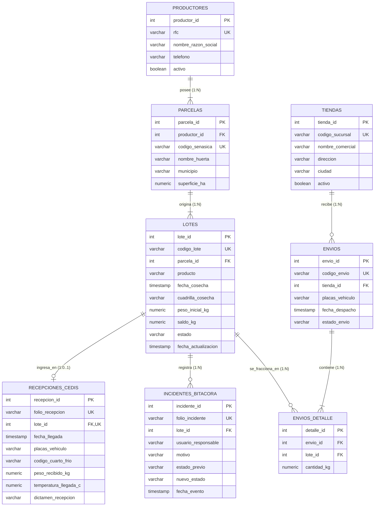

# Decisión de Diseño: Modelo Relacional en PostgreSQL

Este documento concentra de forma independiente el razonamiento, las reglas de integridad, la definición completa de tablas, atributos, relaciones, restricciones, índices y vistas para la capa relacional de **TrazaAgro** en **PostgreSQL**. Sirve como referencia técnica directa junto con [01-arquitectura-tres-bases.md](file:///c:/Users/Emilia/OneDrive/Documentos/Emilia/UP/DaaS/proyecto-final/docs/decisiones/01-arquitectura-tres-bases.md) y [02-modelo-documental-mongodb.md](file:///c:/Users/Emilia/OneDrive/Documentos/Emilia/UP/DaaS/proyecto-final/docs/decisiones/02-modelo-documental-mongodb.md), y complementa el diseño general en [02-modelado-datos.md](file:///c:/Users/Emilia/OneDrive/Documentos/Emilia/UP/DaaS/proyecto-final/docs/02-modelado-datos.md).

## 1. Enfoque de diseño, casos de uso y permisos

PostgreSQL es la **fuente de verdad transaccional y administrativa** del sistema. Se encarga exclusivamente de los datos estructurados que exigen consistencia ACID estricta, llaves foráneas, control de concurrencia y candados de negocio que nunca pueden romperse:

* **CU-REL-01 (Registrar cosecha y crear lote):** Productor o Empacadora da de alta un nuevo lote ligado a una parcela certificada, generando su código único (`codigo_lote`), su `peso_inicial_kg` y su `saldo_kg` inicial.
* **CU-REL-02 (Recepción física y control de cadena de frío en CEDIS):** Recepción registra el arribo del camión, peso real recibido y temperatura. Si la temperatura sale del rango permitido (4.0 a 8.0 °C en aguacate Hass), el backend retiene automáticamente el lote en estado `En revision`.
* **CU-REL-03 (Despacho fraccionado con descuento atómico de inventario):** Almacén surte envíos a tiendas descontando kilogramos del `saldo_kg` mediante bloqueo pesimista (`SELECT ... FOR UPDATE`), impidiendo sobreventa concurrente o salidas de producto que no esté en estado `Liberado`.
* **CU-REL-04 (Bloqueo o liberación atómica por QA):** QA cambia el estado de un lote y asienta en la misma transacción el registro legal en `incidentes_bitacora`.
* **CU-REL-05 (Auditoría y reportes operativos):** Gerencia y QA consultan saldos vivos, cumplimiento de cadena de frío, volumen cosechado por productor/parcela y despachos por tienda.

### Permisos por actor en la capa relacional

| Actor del sistema | Qué registra o modifica en PostgreSQL | Qué puede consultar | Restricciones de acceso y modificación |
| :--- | :--- | :--- | :--- |
| **Productor / Empacadora** | Altas en `lotes` (estado inicial `Cosechado`) ligados a sus propias `parcelas`. | Estado y saldo únicamente de sus propios lotes. | No ve lotes ni precios/volúmenes de otros productores; no puede liberar ni despachar lotes. |
| **Recepción CEDIS** | Altas en `recepciones_cedis` y actualización de estado a `Recibido` o `En revision`. | Lotes esperados, historial de recepciones de su centro. | No puede cambiar un lote a `Liberado` ni modificar `peso_inicial_kg`. |
| **Almacén CEDIS** | Altas en `envios` y `envios_detalle`, con descuento transaccional de `lotes.saldo_kg`. | Inventario disponible (`v_lotes_listos_despacho`) y envíos programados. | Bloqueo estricto para despachar lotes en `Bloqueado`, `En revision` o `Retirado`; no edita `incidentes_bitacora`. |
| **QA e Inocuidad** | Cambios de `lotes.estado` (`Liberado`, `Bloqueado`, `Retirado`) e inserciones en `incidentes_bitacora`. | Todas las tablas, bitácoras y vistas de auditoría (`v_auditoria_cadena_frio`). | Prohibido borrar registros de `incidentes_bitacora` o alterar envíos históricos ya confirmados. |
| **Gerencia / Auditor** | Ninguna escritura operativa directa. | Reportes globales de inventario, mermas, entregas y bitácoras de incidentes. | Solo lectura sobre todo el esquema relacional. |

## 2. Diagrama Entidad-Relación y cardinalidades

El modelo relacional se compone de **8 tablas normalizadas**. Entidades como *Vehículo* y *Cuarto Frío* se conservan aquí únicamente como atributos operativos (`placas_vehiculo`, `codigo_cuarto_frio`) para no inflar el esquema SQL, ya que su conectividad física se modela como nodos puente en Neo4j. Por su parte, *Análisis de Laboratorio* y *Actas físicas* viven en MongoDB referenciando `codigo_lote` y `folio_recepcion`.



### Resumen de cardinalidades

* **`productores` (1) → `parcelas` (N):** Un productor puede registrar una o varias parcelas; cada parcela pertenece a un único productor.
* **`parcelas` (1) → `lotes` (N):** De una parcela se cosechan múltiples lotes en distintas fechas; cada lote proviene de una sola parcela.
* **`lotes` (1) → `recepciones_cedis` (0..1):** Un lote recién cosechado aún no tiene recepción; al ingresar al CEDIS genera un único registro formal de entrada.
* **`tiendas` (1) → `envios` (N):** Una tienda recibe múltiples envíos; cada orden de envío tiene una sola tienda destino.
* **`lotes` (N) ↔ `envios` (M) vía `envios_detalle`:** Un lote grande (ej. 2,000 kg) se divide en 8 a 12 envíos, y un envío a tienda puede completarse mezclando cajas de dos o más lotes distintos. `envios_detalle` resuelve esta relación `N:M` descontando el peso exacto de cada lote.
* **`lotes` (1) → `incidentes_bitacora` (N):** Un lote acumula cero o varios eventos históricos de liberación, bloqueo o retiro por parte de QA.

## 3. Tablas definitivas, atributos y restricciones

### Tabla 1: `productores`
Catálogo maestro de proveedores agrícolas.

| Columna | Tipo de dato | Nulabilidad | Clave / Unicidad | Restricciones adicionales |
| :--- | :--- | :--- | :--- | :--- |
| `productor_id` | `SERIAL` | `NOT NULL` | `PK` | Autoincremental |
| `rfc` | `VARCHAR(13)` | `NOT NULL` | `UNIQUE` | Identificación fiscal única |
| `nombre_razon_social` | `VARCHAR(120)` | `NOT NULL` | — | — |
| `telefono` | `VARCHAR(15)` | `NOT NULL` | — | — |
| `activo` | `BOOLEAN` | `NOT NULL` | — | `DEFAULT TRUE` |

### Tabla 2: `parcelas`
Unidades de cultivo certificadas asociadas a un productor.

| Columna | Tipo de dato | Nulabilidad | Clave / Unicidad | Restricciones adicionales |
| :--- | :--- | :--- | :--- | :--- |
| `parcela_id` | `SERIAL` | `NOT NULL` | `PK` | Autoincremental |
| `productor_id` | `INTEGER` | `NOT NULL` | `FK` → `productores(productor_id)` | `ON DELETE RESTRICT` |
| `codigo_senasica` | `VARCHAR(30)` | `NOT NULL` | `UNIQUE` | Registro fitosanitario oficial |
| `nombre_huerta` | `VARCHAR(100)` | `NOT NULL` | — | — |
| `municipio` | `VARCHAR(60)` | `NOT NULL` | — | — |
| `superficie_ha` | `NUMERIC(6,2)` | `NULL` | — | `CHECK (superficie_ha > 0)` |

### Tabla 3: `lotes`
Fuente de verdad del inventario disponible en kilogramos y del estado operativo de inocuidad.

| Columna | Tipo de dato | Nulabilidad | Clave / Unicidad | Restricciones adicionales |
| :--- | :--- | :--- | :--- | :--- |
| `lote_id` | `SERIAL` | `NOT NULL` | `PK` | Autoincremental; llave interna rápida para `JOIN` |
| `codigo_lote` | `VARCHAR(30)` | `NOT NULL` | `UNIQUE` | Clave natural puente hacia MongoDB y Neo4j (ej. `AGU-P014-260312-01`) |
| `parcela_id` | `INTEGER` | `NOT NULL` | `FK` → `parcelas(parcela_id)` | `ON DELETE RESTRICT` |
| `producto` | `VARCHAR(60)` | `NOT NULL` | — | Ej. `Aguacate Hass` |
| `fecha_cosecha` | `TIMESTAMP` | `NOT NULL` | — | — |
| `cuadrilla_cosecha` | `VARCHAR(50)` | `NOT NULL` | — | — |
| `peso_inicial_kg` | `NUMERIC(10,2)` | `NOT NULL` | — | `CHECK (peso_inicial_kg > 0)` |
| `saldo_kg` | `NUMERIC(10,2)` | `NOT NULL` | — | `CHECK (saldo_kg >= 0 AND saldo_kg <= peso_inicial_kg)` |
| `estado` | `VARCHAR(20)` | `NOT NULL` | — | `CHECK (estado IN ('Cosechado', 'Recibido', 'En revision', 'Liberado', 'Bloqueado', 'Retirado'))` |
| `fecha_actualizacion` | `TIMESTAMP` | `NOT NULL` | — | `DEFAULT CURRENT_TIMESTAMP` |

### Tabla 4: `recepciones_cedis`
Control físico de entrada al almacén (pesaje real y monitoreo de temperatura al abrir el transporte).

| Columna | Tipo de dato | Nulabilidad | Clave / Unicidad | Restricciones adicionales |
| :--- | :--- | :--- | :--- | :--- |
| `recepcion_id` | `SERIAL` | `NOT NULL` | `PK` | Autoincremental; llave interna entera |
| `folio_recepcion` | `VARCHAR(25)` | `NOT NULL` | `UNIQUE` | Ej. `REC-2026-0104`; llave puente hacia `actas_recepcion` en MongoDB |
| `lote_id` | `INTEGER` | `NOT NULL` | `FK` → `lotes(lote_id)`, `UNIQUE` | `ON DELETE RESTRICT` (garantiza relación `1:0..1`) |
| `fecha_llegada` | `TIMESTAMP` | `NOT NULL` | — | `DEFAULT CURRENT_TIMESTAMP` |
| `placas_vehiculo` | `VARCHAR(15)` | `NOT NULL` | — | Se propaga a Neo4j como nodo `:Vehiculo` |
| `codigo_cuarto_frio` | `VARCHAR(15)` | `NOT NULL` | — | Ej. `CF-02`; se propaga a Neo4j como nodo `:CuartoFrio` |
| `peso_recibido_kg` | `NUMERIC(10,2)` | `NOT NULL` | — | `CHECK (peso_recibido_kg > 0)` |
| `temperatura_llegada_c` | `NUMERIC(4,1)` | `NOT NULL` | — | Tolerancia en transporte/recepción aguacate: 4.0 a 8.0 °C (cuarto frío: 5.0 a 7.0 °C) |
| `dictamen_recepcion` | `VARCHAR(20)` | `NOT NULL` | — | `CHECK (dictamen_recepcion IN ('Conforme', 'Retenido', 'Rechazado'))` |

### Tabla 5: `tiendas`
Catálogo de clientes, cadenas comerciales y restaurantes receptores.

| Columna | Tipo de dato | Nulabilidad | Clave / Unicidad | Restricciones adicionales |
| :--- | :--- | :--- | :--- | :--- |
| `tienda_id` | `SERIAL` | `NOT NULL` | `PK` | Autoincremental |
| `codigo_sucursal` | `VARCHAR(20)` | `NOT NULL` | `UNIQUE` | Llave puente hacia nodo `:Tienda` en Neo4j |
| `nombre_comercial` | `VARCHAR(100)` | `NOT NULL` | — | — |
| `direccion` | `VARCHAR(200)` | `NOT NULL` | — | — |
| `ciudad` | `VARCHAR(60)` | `NOT NULL` | — | — |
| `activo` | `BOOLEAN` | `NOT NULL` | — | `DEFAULT TRUE` (evita borrados físicos conforme a `RN-10`) |

### Tabla 6: `envios`
Cabecera de remisión o despacho de salida desde el CEDIS hacia un cliente.

| Columna | Tipo de dato | Nulabilidad | Clave / Unicidad | Restricciones adicionales |
| :--- | :--- | :--- | :--- | :--- |
| `envio_id` | `SERIAL` | `NOT NULL` | `PK` | Autoincremental |
| `codigo_envio` | `VARCHAR(30)` | `NOT NULL` | `UNIQUE` | Ej. `ENV-2026-1052`; llave puente hacia nodo `:Envio` en Neo4j |
| `tienda_id` | `INTEGER` | `NOT NULL` | `FK` → `tiendas(tienda_id)` | `ON DELETE RESTRICT` |
| `placas_vehiculo` | `VARCHAR(15)` | `NOT NULL` | — | Unidad de reparto que se propaga a Neo4j |
| `fecha_despacho` | `TIMESTAMP` | `NOT NULL` | — | `DEFAULT CURRENT_TIMESTAMP` |
| `estado_envio` | `VARCHAR(20)` | `NOT NULL` | — | `CHECK (estado_envio IN ('Preparado', 'En transito', 'Entregado', 'Cancelado'))` |

### Tabla 7: `envios_detalle`
Desglose fraccionado de kilogramos tomados de cada lote para surtir un envío.

| Columna | Tipo de dato | Nulabilidad | Clave / Unicidad | Restricciones adicionales |
| :--- | :--- | :--- | :--- | :--- |
| `detalle_id` | `SERIAL` | `NOT NULL` | `PK` | Autoincremental |
| `envio_id` | `INTEGER` | `NOT NULL` | `FK` → `envios(envio_id)` | `ON DELETE CASCADE` |
| `lote_id` | `INTEGER` | `NOT NULL` | `FK` → `lotes(lote_id)` | `ON DELETE RESTRICT` |
| `cantidad_kg` | `NUMERIC(10,2)` | `NOT NULL` | — | `CHECK (cantidad_kg > 0)` |
| **Compuesta** | `(envio_id, lote_id)` | — | `UNIQUE` | Evita líneas duplicadas del mismo lote en un envío |

### Tabla 8: `incidentes_bitacora`
Historial legal inalterable de transiciones críticas de estado ejecutadas por QA.

| Columna | Tipo de dato | Nulabilidad | Clave / Unicidad | Restricciones adicionales |
| :--- | :--- | :--- | :--- | :--- |
| `incidente_id` | `SERIAL` | `NOT NULL` | `PK` | Autoincremental |
| `folio_incidente` | `VARCHAR(30)` | `NOT NULL` | `UNIQUE` | Ej. `INC-2026-0012`; llave puente 1:1 hacia `expedientes_incidentes` en MongoDB |
| `lote_id` | `INTEGER` | `NOT NULL` | `FK` → `lotes(lote_id)` | `ON DELETE RESTRICT` |
| `usuario_responsable` | `VARCHAR(60)` | `NOT NULL` | — | Nombre o identificador del analista/responsable QA |
| `motivo` | `VARCHAR(250)` | `NOT NULL` | — | Causa documentada del bloqueo, liberación o retiro |
| `estado_previo` | `VARCHAR(20)` | `NOT NULL` | — | `CHECK (estado_previo IN ('Cosechado', 'Recibido', 'En revision', 'Liberado', 'Bloqueado', 'Retirado'))` |
| `nuevo_estado` | `VARCHAR(20)` | `NOT NULL` | — | `CHECK (nuevo_estado IN ('Cosechado', 'Recibido', 'En revision', 'Liberado', 'Bloqueado', 'Retirado'))` |
| `fecha_evento` | `TIMESTAMP` | `NOT NULL` | — | `DEFAULT CURRENT_TIMESTAMP` |

### Tabla consolidada de relaciones e integridad referencial

| Tabla hija | Columna FK | Tabla padre | Política `ON DELETE` | Regla de negocio protegida |
| :--- | :--- | :--- | :--- | :--- |
| `parcelas` | `productor_id` | `productores` | `RESTRICT` | No se puede borrar un productor si tiene huertas registradas. |
| `lotes` | `parcela_id` | `parcelas` | `RESTRICT` | Impide eliminar una parcela con historial de lotes cosechados. |
| `recepciones_cedis` | `lote_id` | `lotes` | `RESTRICT` | Protege el vínculo 1:0..1 de la llegada física del lote. |
| `envios` | `tienda_id` | `tiendas` | `RESTRICT` | Conserva el historial de entregas aunque una sucursal cierre. |
| `envios_detalle` | `envio_id` | `envios` | `CASCADE` | Si se elimina una cabecera en borrador, se limpian sus líneas de detalle. |
| `envios_detalle` | `lote_id` | `lotes` | `RESTRICT` | Impide borrar un lote que ya fue fraccionado y despachado. |
| `incidentes_bitacora` | `lote_id` | `lotes` | `RESTRICT` | Preserva la pista de auditoría sanitaria de todo lote evaluado. |

## 4. Índices estratégicos y vistas operativas

En PostgreSQL, toda llave primaria (`PK`) y restricción `UNIQUE` (como `lotes.codigo_lote`, `productores.rfc`, `parcelas.codigo_senasica`, `tiendas.codigo_sucursal`, `envios.codigo_envio` y `recepciones_cedis.folio_recepcion`) genera automáticamente un índice B-Tree. Los índices adicionales definidos a continuación cubren llaves foráneas (que PostgreSQL no indexa por defecto) y los filtros de negocio de mayor frecuencia.

### Índices explícitos justificados

| Nombre del índice | Tabla y columnas | Tipo | Patrón de consulta que optimiza |
| :--- | :--- | :--- | :--- |
| `idx_parcelas_productor` | `parcelas(productor_id)` | B-Tree | Reportes de cosecha agrupados por productor y consulta de huertas propias. |
| `idx_lotes_parcela` | `lotes(parcela_id)` | B-Tree | Rastreos hacia atrás de lotes por huerta y reportes mensuales de producción por parcela. |
| `idx_lotes_estado_producto` | `lotes(estado, producto)` | B-Tree | Listado rápido de inventario disponible (`WHERE estado = 'Liberado' AND producto = ...`). |
| `idx_lotes_fecha_cosecha` | `lotes(fecha_cosecha)` | B-Tree | Cortes mensuales de cosecha por parcela o productor. |
| `idx_recepciones_temperatura` | `recepciones_cedis(temperatura_llegada_c)` | B-Tree | Auditorías de cadena de frío para detectar entregas fuera de rango (`< 4.0` o `> 8.0` °C). |
| `idx_envios_tienda` | `envios(tienda_id)` | B-Tree | Historial de pedidos y volúmenes entregados por sucursal. |
| `idx_envios_fecha_estado` | `envios(fecha_despacho, estado_envio)` | B-Tree | Cálculo de kilogramos recibidos por tienda en los últimos 7 días excluyendo cancelados. |
| `idx_envios_detalle_lote` | `envios_detalle(lote_id)` | B-Tree | Verificación de despachos realizados por lote (la restricción `UNIQUE(envio_id, lote_id)` solo cubre búsquedas empezando por `envio_id`). |
| `idx_incidentes_lote_fecha` | `incidentes_bitacora(lote_id, fecha_evento DESC)` | B-Tree | Consulta inmediata de quién bloqueó un lote, cuándo y por qué motivo. |

### Vistas operativas recomendadas

Estas dos vistas simplifican las consultas recurrentes del backend para almacén y QA sin duplicar lógica en SQL:

**1. `v_lotes_listos_despacho`**
Expone únicamente los lotes que cumplen las dos condiciones para salir a venta (`estado = 'Liberado'` y `saldo_kg > 0`), enriquecidos con el nombre del producto, la huerta y el productor.

```sql
CREATE VIEW v_lotes_listos_despacho AS
SELECT
    l.codigo_lote,
    l.producto,
    l.fecha_cosecha,
    l.saldo_kg,
    pa.nombre_huerta,
    pr.nombre_razon_social AS productor
FROM lotes l
JOIN parcelas pa ON l.parcela_id = pa.parcela_id
JOIN productores pr ON pa.productor_id = pr.productor_id
WHERE l.estado = 'Liberado'
  AND l.saldo_kg > 0;
```

**2. `v_auditoria_cadena_frio`**
Detecta de inmediato los lotes recibidos cuya temperatura de llegada estuvo fuera del rango óptimo de aguacate Hass (4.0 a 8.0 °C), mostrando su estado actual para detectar anomalías como lotes fuera de rango que sigan `Liberado`.

```sql
CREATE VIEW v_auditoria_cadena_frio AS
SELECT
    l.codigo_lote,
    l.producto,
    l.estado AS estado_lote,
    r.folio_recepcion,
    r.fecha_llegada,
    r.temperatura_llegada_c,
    r.dictamen_recepcion,
    r.placas_vehiculo
FROM lotes l
JOIN recepciones_cedis r ON l.lote_id = r.lote_id
WHERE r.temperatura_llegada_c < 4.0 OR r.temperatura_llegada_c > 8.0;
```

## 5. Transacciones críticas y consultas de validación

### Transacción ACID de despacho fraccionado (CU-REL-03)

Garantiza que ningún operador pueda sobrevender kilogramos ni despachar un lote bloqueado en accesos concurrentes:

```sql
BEGIN;

SELECT lote_id, saldo_kg, estado
FROM lotes
WHERE codigo_lote = 'AGU-P014-260312-01'
FOR UPDATE;

-- Validación en servicio de aplicación: estado = 'Liberado' AND saldo_kg >= 250.00 (lote_id = 14)

UPDATE lotes
SET saldo_kg = saldo_kg - 250.00,
    fecha_actualizacion = CURRENT_TIMESTAMP
WHERE lote_id = 14;

INSERT INTO envios (codigo_envio, tienda_id, placas_vehiculo, estado_envio)
VALUES ('ENV-2026-1052', 42, 'TRK-884-A', 'Preparado')
RETURNING envio_id;

INSERT INTO envios_detalle (envio_id, lote_id, cantidad_kg)
VALUES (1052, 14, 250.00);

COMMIT;
```

### Consultas de control de consistencia e integridad

* **Cuadre de inventario por lote (`cosechado - saldo_kg = despachado`):**
```sql
SELECT
    l.codigo_lote,
    l.peso_inicial_kg AS cosechado_kg,
    l.saldo_kg,
    (l.peso_inicial_kg - l.saldo_kg) AS diferencia_inventario_kg,
    COALESCE(SUM(CASE WHEN e.estado_envio <> 'Cancelado' THEN ed.cantidad_kg ELSE 0 END), 0) AS total_despachado_kg,
    (l.peso_inicial_kg - l.saldo_kg) = COALESCE(SUM(CASE WHEN e.estado_envio <> 'Cancelado' THEN ed.cantidad_kg ELSE 0 END), 0) AS coincide
FROM lotes l
LEFT JOIN envios_detalle ed ON l.lote_id = ed.lote_id
LEFT JOIN envios e ON ed.envio_id = e.envio_id
WHERE l.codigo_lote = 'AGU-P014-260312-01'
GROUP BY l.lote_id, l.codigo_lote, l.peso_inicial_kg, l.saldo_kg;
```

* **Detección de envíos posteriores a un bloqueo o revisión:**
```sql
SELECT DISTINCT
    l.codigo_lote,
    l.estado AS estado_actual,
    ib.nuevo_estado AS estado_incidente,
    ib.fecha_evento AS fecha_bloqueo,
    e.codigo_envio,
    e.fecha_despacho
FROM lotes l
JOIN incidentes_bitacora ib ON l.lote_id = ib.lote_id
JOIN envios_detalle ed ON l.lote_id = ed.lote_id
JOIN envios e ON ed.envio_id = e.envio_id
WHERE l.estado IN ('En revision', 'Bloqueado')
  AND ib.nuevo_estado IN ('En revision', 'Bloqueado')
  AND e.estado_envio <> 'Cancelado'
  AND e.fecha_despacho > ib.fecha_evento;
```
